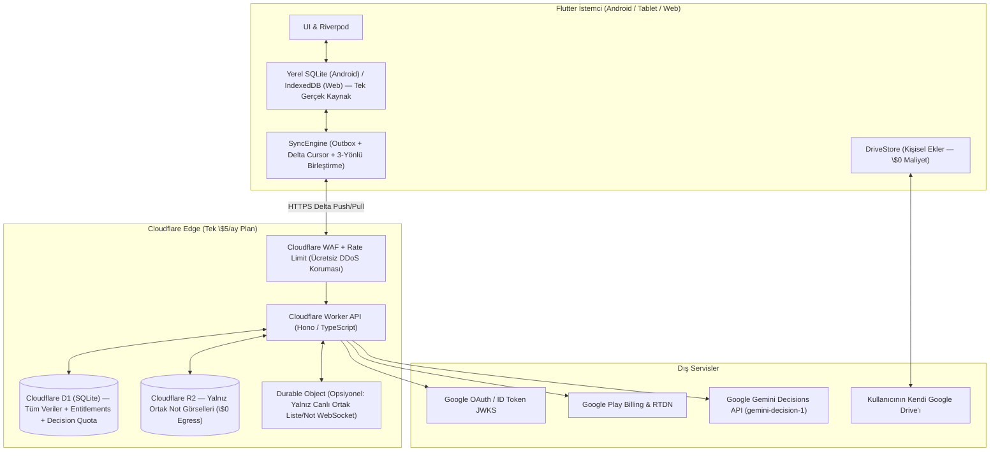
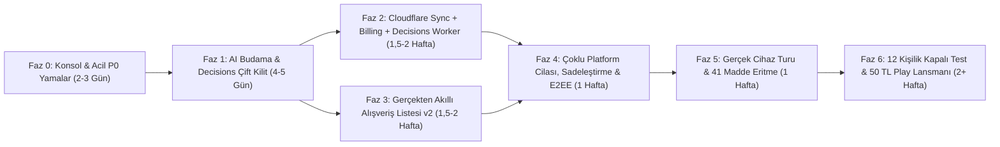

# Yeni Ana Yol Haritası — Sade, Kârlı (50 TL Tek Sefer), Cloudflare Senkronlu ve Gerçekten Akıllı Alışveriş Listeli Uygulama Planı

> **Tarih:** 24 Kasım 2026 · **Durum:** Onay / Uygulama Öncesi Ana Plan (depo dosyalarına dokunulmadı)  
> **Çoklu Oturum Notu:** `origin/main` üzerinde yerel kopyadan 1 commit önde yeni bir çalışma tespit edildi (`9a24cdb` — *"Tablo varken madde silinince yazılar tablonun üstüne binmiyor [apk]"*). Bu plan, başka bir oturumun `main` üzerindeki işleriyle çakışmayacak şekilde fazlandırılmıştır.


> **Önceki plan arşivi:** `docs/arsiv/planlar/PLAN_2026-11-17.md` (17 Kasım 2026 planı ve önceki fazların tamamlanma kayıtları).

---

## 0. Stratejik Özet — Neden Bu Yeni Model Oyunu Değiştiriyor?

Önceki mimaride iki yapısal kilitlenme vardı: (1) Ağır üretken AI + Firebase Storage + Firestore okuma maliyetleri düşük fiyatla taşınamıyordu; (2) 30'a yakın AI akışı, 127 ayar ve çift katman karmaşası ürünü boğuyordu.

Yeni yön — **Ağır AI'ı kaldır + Yalnız `gemini-decision-1` (sınırlı bütçeli) + 50 TL tek seferlik model + Cloudflare senkronu + Gerçekten Akıllı Alışveriş Listesi** — dört büyük sorunu **tek hamlede** çözüyor:

1. **Maliyet Sıfıra Yaklaşır:** Üretken Gemini AI ve Firebase Storage egress (\$0,12/GB) tamamen kalkar. Cloudflare Workers + D1 ile 100.000 aktif kullanıcıda bile metin senkron maliyeti **kişi başı yılda ~\$0,004 (15 kuruş)** seviyesine iner.
2. **50 TL Tek Seferlik Model Matematiksel Olarak Kârlı Olur:** Çift kilitli (`750 karar` + `600.000 girdi jetonu`) Decisions API bütçesiyle kullanıcı başına maksimum AI maliyeti **garantili \$0,06** olur. Ücretsiz kullanıcıların senkron yükü düşüldükten sonra bile **%45–55 net kâr marjı** kalır.
3. **Uygulama Hafifler ve Hızlanır:** Ağır AI kodları, `firebase_ai`, `lib/features/gmail/` ve gereksiz katmanlar çıktığında ~15.000+ satır kod, ~8–12 MB paket boyutu ve ~40–60 MB RAM yükü düşer.
4. **Rakiplerin Kopyalayamayacağı Gerçek Bir Niş Doğar:** *"Aboneliksiz, reklamsız, tek sefer 50 TL; Türkçe sesli hızlı not, gerçekten akıllı market/bütçe listesi, defter & PDF kalemi."*

---

## 1. Çoklu Oturum Güvenlik Protokolü (`main` Çakışma Koruması)

Başka bir oturum `main`'de aktif çalışırken (ör. tablo/editör düzeltmeleri) bu planı uygulamaya koyarken şu 4 kural zorunlu olmalıdır:

1. **Her faz taze `origin/main`'den izole dalda başlar:**  
   `git fetch origin && git checkout -b plan/faz-N-<ad> origin/main`
2. **Dosya sahipliği ayrımı:** Diğer oturum `note_editor_screen.dart` / `table_page_box.dart` gibi editör çekirdeğinde çalışıyorsa, önce **sıfır çakışmalı** arka uç ve bağımsız modül fazları (Faz 1: `functions/`, `notes_delta_sync.dart`, `storage.rules`; Faz 2: `cloudflare/` yeni dizin; Faz 4: yeni `shopping/` modülü) uygulanır.
3. **Play sürümü 0 kullanıcıyla başlar:** Play uygulaması ayrı paket adı ve ayrı altyapıyla açılacağı için Cloudflare geçişi mevcut kişisel APK'nın (`dev.kaimau.notlar` / `notlar-kaimau`) canlı verisini **hiç riske atmaz**.
4. **Tek birleştirme kuralı:** Her faz kendi testleriyle yeşillenip `origin/main` üstüne rebase edilerek tek temiz commit/merge ile alınır.

---

## 2. Bölüm A — AI Sadeleştirme ve 50 TL Tek Seferlik Limit Matematiği

### 2.1 Kaldırılacak AI Modülleri (Üretken & Pahalı Katman)

Aşağıdaki özellikler Play sürümünden (tercihen tüm kod tabanından) çıkarılarak hem fatura riski hem arayüz kalabalığı temizlenir:

| Kaldırılacak Modül / Özellik | Kod Yeri | Neden Kalkıyor? |
|---|---|---|
| **Firebase AI Logic SDK** | `pubspec.yaml` (`firebase_ai`), [`firebase_ai_client.dart`](lib/features/ai/data/firebase_ai_client.dart) | İstemciden doğrudan çağrıldığı için sunucu kotası yok, üretken model maliyeti 50 TL modelle uyumsuz. |
| **Tüm Notlarla / PDF ile Üretken Sohbet** | [`ai_chat_screen.dart`](lib/features/ai/presentation/ai_chat_screen.dart), [`chat_controller.dart`](lib/features/ai/presentation/chat_controller.dart), [`assistant_service.dart`](lib/features/ai/data/assistant_service.dart) | Uzun sohbet bağlamı + PDF token maliyeti çok yüksek; bakım yükü büyük. |
| **AI Levhası & Yeniden Yaz / Özet / Çevir / Brifing** | [`ai_sheet.dart`](lib/features/ai/presentation/ai_sheet.dart), [`ai_hub_screen.dart`](lib/features/ai/presentation/ai_hub_screen.dart), [`briefing_screen.dart`](lib/features/ai/presentation/briefing_screen.dart) | 50 TL tek seferlik modelde sürdürülemez; ayrıca yazım denetimi v3 zaten cihazda ücretsiz çalışıyor. |
| **Anlamsal Arama (Embedding) & Vektör Önbelleği** | [`semantic_search.dart`](lib/features/ai/data/semantic_search.dart) | Her not değişikliğinde embedding çağrısı + RAM/disk yükü. Yerel tam metin + ek metin araması yeterli. |
| **AI Ses/Video Dökümü, Podcast & Gemini TTS** | [`media_transcriber.dart`](lib/features/notes/data/media_transcriber.dart), [`listen_screen.dart`](lib/features/ai/presentation/listen_screen.dart), [`ai_speech.dart`](lib/features/ai/data/ai_speech.dart) | En yüksek token maliyeti; cihazda dikte + sistem TTS ücretsiz kalır. |
| **Çoklu Sağlayıcı (OpenAI / Anthropic / OpenRouter)** | [`provider_chat.dart`](lib/features/ai/data/provider_chat.dart), [`model_catalog.dart`](lib/features/ai/data/model_catalog.dart) | 4 sağlayıcı + 2.796 satırlık [`gemini_service.dart`](lib/features/ai/data/gemini_service.dart) karmaşasını bitirir. |
| **Günlük Puan Sistemi & Eski Premium Ekranı** | [`ai_gate.dart`](lib/features/ai/data/ai_gate.dart), [`premium_screen.dart`](lib/features/settings/presentation/premium_screen.dart) | 30/300 günlük puan modeli kalkıyor; tek net Decisions kredi sayacı geliyor. |

> [!TIP]
> **Kalan Sıfır Maliyetli Cihaz İçi "Akıllı" Özellikler (Tüm Kullanıcılara Ücretsiz ve Çevrimdışı):**  
> Türkçe ek çözücülü yazım denetimi v3 · Cihazda sesli dikte & Türkçe tarih/saat/tekrar ayrıştırıcısı · ML Kit ücretsiz belge tarama & aranabilir PDF OCR · Barkod tarama (`mobile_scanner`) · Cihazda kopya not ve çöp kuralları · Sistem sesiyle okuma (TTS) · Yerel akıllı alışveriş sözlüğü ve tekrar alma tahmini.

### 2.2 Yalnız Google Decisions API (`gemini-decision-1`) Kullanım Noktaları

`gemini-decision-1` üretken metin yazmaz; **evet/hayır (`noul`)**, **çoktan seçmeli (`choice`, 2–255 seçenek)** ve **puanlama (`score`)** yapar. **Fiyatı (Doğrulandı, Kasım 2026):** 1M girdi jetonu **\$0,10**, çıktı jetonu **\$0,00**!

Uygulamada yalnızca **en yüksek fayda / en düşük jeton** oranlı 5 noktada çalışır (her zaman önce yerel kural çalışır, belirsiz kalırsa Decisions çağrılır ve sonuç kalıcı önbelleğe yazılır):

| # | Karar Noktası | Nasıl Çalışır? | Ort. Jeton | Çağrı Maliyeti |
|---|---|---|---:|---:|
| **D1** | **Alışveriş Reyonu Öğrenme (`shopAisle`)** | Sözlüğün tanımadığı yeni/markalı ürünü (`"Torku Banada"`, `"Kedi kumu"`, `"Chia"`) 13 reyondan birine atar → **kalıcı yerel hafızaya yazar (bir daha asla sormaz!)** | ~250 | \$0,000025 |
| **D2** | **Hızlı Ekle Hedef Notu (`dropTarget`)** | Yerel ayrıştırıcı hedefi bulamazsa cümleyi ≤30 not başlığı arasında `choice` ile doğru nota yönlendirir | ~550 | \$0,000055 |
| **D3** | **Tek Cümle Niyet Yönlendirici (`captureRoute`)** | Konuşulan/yazılan cümleyi tek çağrıda sınıflandırır: *Alışveriş maddesi mi · Yapılacak/hatırlatıcı mı · Takvim etkinliği mi · Düz not mu · Mevcut nota ekleme mi?* | ~450 | \$0,000045 |
| **D4** | **Sessiz Düzen (`noteTriage`)** | Tek çağrıda kullanıcının mevcut klasör/etiketleri arasından öneri + *"Bu notta hatırlatıcı olmalı mı?"* + *"Hassas bilgi (şifre/IBAN) içeriyor mu?"* | ~700 | \$0,000070 |
| **D5** | **Akıllı Liste Türü & Çoklu Ürün Ayrımı (`listClassify`)** | Yeni listenin türünü (Market / Bavul / Eczane / Kırtasiye / Hırdavat / Kamp / Bebek / Spor) ve başlık doğruluğunu belirler | ~350 | \$0,000035 |

### 2.3 50 TL Tek Seferlik Kesin Birim Ekonomi ve Çift Kilitli Limit Hesabı

**Gelir Hesabı (50 TL Tek Seferlik Satış — Türkiye Google Play):**
- Brüt fiyat: **50,00 TL** (~\$1,40 @ ~35,5 TL/\$)
- KDV (%20 içinden): ~−8,33 TL
- Google Play (%15 küçük geliştirici payı): ~−6,25 / −7,50 TL
- GVK Mük. 20/B Stopajı (%15): ~−5,25 TL
- **Elde Kalan Net Gelir:** **~29–30 TL ≈ \$0,80–\$0,85 NET**

**Maliyet Bütçesi Dağılımı (1 Ücretli Kullanıcı, 5 Yıllık Ömür Boyu):**

| Kalem | Hesap | Tutar (USD) |
|---|---|---:|
| **Net Gelir (50 TL Tek Sefer)** | Vergi + Play sonrası | **+\$0,82** |
| **Decisions API Bütçesi (SERT TAVAN)** | **600.000 girdi jetonu** (× \$0,10 / 1M) | **−\$0,06** |
| **Cloudflare Senkron (Kendi + 15 Ücretsiz Kullanıcı Payı)** | 16 kullanıcı × \$0,004/yıl × 5 yıl | **−\$0,32** |
| **Kalan NET KÂR (Her Şey Çıktıktan Sonra)** | **%53 Net Kâr Marjı** | **+\$0,44** |

> [!IMPORTANT]
> **Önerilen Kesin Limit Formülü (Çift Kilit — Kötüye Kullanıma %100 Dayanıklı):**
> - **Kullanıcıya görünen hak:** **50 TL Tek Seferlik Paket = 750 Akıllı Karar Hakkı** (kalıcı yerel önbellek sayesinde normal kullanıcıya **1,5–3 yıl** yeter; bitince tüm uygulama ve cihaz içi kurallar sınırsız çalışmaya devam eder).
> - **Sunucudaki görünmez güvenlik tavanı:**
>   1. İstek başı toplam payload sınırı: **≤ 8.000 karakter** (~2.500 jeton maks — mevcut `functions/decisions_util.js`'deki 248.000 karakterlik açığı tamamen kapatır!).
>   2. Kişi başı toplam jeton tavanı: **600.000 `total_input_tokens`** (Google'ın yanıtındaki gerçek `usage.total_input_tokens` değerinden düşülür → **maksimum maliyet asla \$0,06'yı geçemez!**).
>   3. Sayaç `uid` değil **`purchase_token_hash`** anahtarına bağlanır → hesap sil-yeniden aç-geri yükle ile sıfırlanamaz!
> - **Hak bitince ne olur?** İsteğe bağlı tüketilebilir Play ürünü: **"+1.000 Akıllı Karar Paketi — 30 TL"** (Net ~\$0,48 gelir, maks \$0,08 maliyet → **%83 kâr marjı**; abonelik baskısı yok!). *(İstersen ayarlarda gizli/ileri seçenek olarak kendi Gemini anahtarıyla sınırsız Decisions desteği de bırakılabilir — maliyeti bize \$0.)*

---

## 3. Bölüm B — Lite (Ücretsiz) vs Tek Seferlik Tam Sürüm (50 TL) Katman Matrisi

**Tek uygulama, 2 net katman, SIFIR reklam, SIFIR abonelik tuzağı.**  
İlke: *"Kullanıcının günlük not ve alışveriş deneyimi ücretsizde kusursuz ve dürüst çalışır; 50 TL tek seferlik yükseltme ise hız, akıllı otomasyon, sınırsız kişiselleştirme ve uzun vadeli güven özelliklerini açar."*

| Özellik | Lite (Ücretsiz — Reklamsız) | Tek Seferlik Tam Sürüm (**50 TL** — Ömür Boyu) |
|---|---|---|
| **Not, Liste, Defter, Tablo, PDF Üstü Kalem, Hatırlatıcı, Takvim** | ✓ Sınırsız | ✓ Sınırsız |
| **Not / Klasör / Cihaz Sayısı** | ✓ Sınırsız | ✓ Sınırsız |
| **Cihaz İçi Akıllı Özellikler** *(Yazım v3, Dikte, ML Kit OCR/Tarama, Barkod Okuma, Akıllı Alışveriş Reyonları, Mağaza Kipi)* | ✓ Tamamen Açık | ✓ Tamamen Açık |
| **Bulut Metin Senkronu (Cloudflare D1)** | ✓ **Aralıklı** (5 dk + uygulama kapanış/arka plan; Android + Web) | ✓ **Anında Senkron** (2–3 sn + canlı ortak düzenleme) |
| **Ek Dosyalar (Fotoğraf, PDF, Ses)** | ✓ Kullanıcının **Kendi Google Drive'ı** (\$0 maliyet) | ✓ Kendi Google Drive'ı **+ Ortak Not/Liste Görselleri (Cloudflare R2, 250 MB adil kullanım)** |
| **Google Decisions API Akıllı Otomasyon** *(Bilinmeyen ürün reyonu, Hızlı Ekle hedefi, Sessiz düzen etiket/klasör, Cümle yönlendirme)* | ✗ (Cihaz içi kurallar + sözlük çalışır) | ✓ **750 Akıllı Karar dahil** *(bitince 30 TL ek +1.000 paket veya opsiyonel kendi Gemini anahtarı)* |
| **Akıllı Alışveriş İleri Özellikleri** | Temel reyon sıralama, Mağaza Kipi, Barkod, Sık alınanlar | **+ Fiyat Hafızası & Market Karşılaştırma · Çoklu Market Profili (`@BİM`/`@Migros`/`@Pazar`) · Özel Reyon Sırası · Aile "Marketteyim" Bildirimi · Tarif/Öğün Paketleri & Bütçe Analizi** |
| **Sürüm Geçmişi (Geri Dönüş)** | Son 3 sürüm (yerel/kısa) | ✓ **Son 30 sürüm** (bulut senkronlu) |
| **Güvenlik & Yedekleme** | Düz `.notyedek` & Markdown `.zip` dışa aktarma | ✓ **Parolalı AES-256 Tam Yedek** + **Uçtan Uca Şifreli (E2EE) Kilitli Notlar** |
| **Görünüm & Kişiselleştirme** | 3 çekirdek tema (Sistem, Adaçayı, Koyu) + varsayılan yazı tipi | ✓ **Tüm temalar, 19 yazı tipi, tüm kâğıt desenleri ve özel zeminler** |
| **Ortak Çalışma** | 1 ortak alışveriş/not listesi (alıcıya kopya gönderme sınırsız) | ✓ **Sınırsız ortak not ve paylaşılan klasör** |

> **Önemli Güvence:** Tam Sürüm alındıktan sonra hiçbir ek aylık ücret çıkmaz; reklam hiç yoktur. Bu teklif ("Tek sefer 50 TL, abonelik yok, reklam yok") Türkiye Google Play'de çok güçlü bir dönüşüm oranı (%5–10+) üretir!

---

## 4. Bölüm C — Acil Kritik Hatalar ve Yeni Yakalanan Eksikler (Önce Bunlar Kapanmalı)

İlk denetimde bulduklarımıza ek olarak, bu turda yapılan derin kod taramasında **5 yeni kritik/yüksek hata** daha yakalandı. Tamamı aşağıdaki tek listededir:

| Öncelik | Hata / Eksik | Kod Yeri | Somut Etki ve Çözüm |
|---|---|---|---|
| **P0-1** | **YENİ: Decisions API 248.000 Karakterlik Maliyet Açığı** | [`functions/decisions_util.js:24-29`](functions/decisions_util.js) | `MAX_QUESTIONS (60) × MAX_QUESTION_JSON (4000) + 8000 = 248.000 karakter (~80K token = \$0,008/çağrı)`. 1 kötü niyetli kullanıcı 1.000 çağrıda **\$8 zarar** ettirir! **Çözüm:** Toplam JSON payload ≤ 8.000 karakter + gerçek `usage.total_input_tokens` (600K tavan) sayımı. |
| **P0-2** | **S1 Delta Senkron Yarış Hatası (Race Condition)** | [`notes_delta_sync.dart:179-219`](lib/features/notes/data/notes_delta_sync.dart) | `checkCount(first.size)` feeder'ı beklemeden çalışıyor → başka cihazda 1 not eklenip silindiğinde veya çevrimdışı açılışta S1 iptal olup tüm koleksiyonu yeniden okuyor. **Çözüm:** `checkCount` yalnızca feeder ilk sunucu snapshot'ını işledikten sonra çalışsın; offline iken `toLegacy` çağırmasın. |
| **P0-3** | **Ömür Boyu Karar Hakkının Hesap Silerek Sıfırlanması** | [`functions/entitlements.js:49`](functions/entitlements.js) | Hesap silinince `decisionUsage/{uid}` siliniyor → yeni hesapla "Satın alımları geri yükle" yapınca hak sıfırdan doluyor. **Çözüm:** Kullanım sayacını `uid` değil `lifetimeTokenKey` (`sha256(purchaseToken)`) altında sakla ve hesap silmede SİLME. |
| **P0-4** | **Decisions Sunucuda `aiKillSwitch` Kontrolü Yok** | [`functions/decisions.js:35-66`](functions/decisions.js) | Acil kapatma bayrağı yalnız istemcide bakılıyor. **Çözüm:** Sunucu/Worker `decide` başında kill switch'i kontrol etsin. |
| **P0-5** | **`searchUsers` 1.000 Belge Taraması & App Check Yok** | [`functions/index.js:90-142`](functions/index.js) | Her aramada 1.000 okuma, App Check yok, 1.000+ kullanıcıda isimler bulunmuyor. **Çözüm:** Cloudflare'e geçince D1 `LIKE 'prefix%'` indeksli 1 ms sorgu; o zamana kadar `enforceAppCheck: true` + prefix token. |
| **P0-6** | **Storage Kurallarında Pro Kapısı ve Toplam Kota Yok** | [`storage.rules:108-117`](storage.rules) | Herkes 50 MB dosya yükleyebilir, egress \$0,12/GB. **Çözüm:** Play'de Storage yerine Drive + (ortak görseller için) Cloudflare R2 (\$0 egress, sunucu boyut/kota kapılı). |
| **P0-7** | **Konsol Korkulukları Eksik** | Firebase / Cloud Konsol | Bütçe uyarısı (\$5/\$20/\$50) ve App Check Enforce hemen açılmalı (kişisel proje için de!). |
| **P1-1** | **YENİ: `StoreModeScreen` Canlı Senkronu Dinlemiyor** | [`store_mode_screen.dart:48`](lib/features/notes/presentation/editor/store_mode_screen.dart) | `widget.initialItems` bir kez kopyalanıyor; ortak alışveriş listesinde eşin/arkadaşın işaretlediği ürünler Mağaza Kipi'nde görünmüyor! **Çözüm:** `noteByIdProvider(noteId)` dinleyen reaktif `ConsumerStatefulWidget`. |
| **P1-2** | **YENİ: Decisions Önbelleği Yalnız Bellek İçi (5 dk / 32 kayıt)** | [`decision_service.dart:113-118`](lib/features/ai/data/decisions/decision_service.dart) | Uygulama kapanınca öğrenilen kararlar unutuluyor ve tekrar kredi yakıyor. **Çözüm:** `shopAisle` ve `noteTriage` kararları kalıcı yerel önbelleğe (SharedPrefs/SQLite) yazılsın. |
| **P1-3** | **YENİ: `.notyedek` / `.zip` İçe Aktarmada Zip Bombası Koruması Yok** | [`backup_service.dart:123-135`](lib/features/notes/data/backup_service.dart), [`note_package.dart`](lib/features/notes/data/note_package.dart) | Açılmış boyut ve dosya sayısı tavanı olmadan belleğe açılıyor (`G-21`). **Çözüm:** Maks. 5.000 dosya / 250 MB açılmış boyut kontrolü. |
| **P1-4** | **YENİ: Web Lite Kullanıcıları Senkron Kısıtını Atlıyor** | [`lite_sync.dart:40-48`](lib/features/notes/data/lite_sync.dart) | Web'de `journalReady == false` olduğu için Lite kullanıcılar anlık bulut yazımı yapıyor. **Çözüm:** Web'de IndexedDB pending queue ile 5 dk + `pagehide`/`visibilitychange` toplu yazım. |
| **P1-5** | **Kilitli Notlar Bulutta Düz Metin (E2EE Yok)** | [`note.dart:1041-1161`](lib/features/notes/domain/note.dart) | Kilitli notun gövdesi bulutta okunabilir. **Çözüm:** Mevcut AES-256 şifreleyiciyi kilitli not gövdesine uygula (anahtar cihaz SecureStorage + kullanıcı kurtarma parolası). |
| **P1-6** | **Çoklu Platform Açık Arayüz Hataları** | [`note_editor_screen.dart:3224`](lib/features/notes/presentation/editor/note_editor_screen.dart), [`app_theme.dart:180`](lib/app/theme/app_theme.dart), [`web_workspace_frame.dart:115`](lib/app/web_workspace/web_workspace_frame.dart), [`settings_account.dart:641`](lib/features/settings/presentation/settings_sections/settings_account.dart) | `KW-11` kalem `Ctrl+Z`, `KW-17` 14 px AppBar başlıkları, `WebWorkspaceFrame` `MediaQuery.of`, yüzen kalem FAB ↔ `"T Ara başlık"` çakışması, Tablet Ayarlar çift Misafir kartı + Misafir'e kırmızı "Oturumu kapat", 3 bölmeli PDF sıkışması, 1.076 token istisnası. |
| **P1-7** | **Ölü Kod, Fazla Widget ve Doğrulama Borcu** | [`lib/features/gmail/`](lib/features/gmail/presentation/gmail_screen.dart), [`KONTROL_LISTEM.md`](KONTROL_LISTEM.md) | 2.268 satır Gmail kodunu sil, `premium_screen.dart`'ı sil, 8 Android widget'ını 3'e indir, `STORE_LISTING.md`'yi güncelle, 41 doğrulanmamış maddeyi gerçek cihazlarda erit. |

---

## 5. Bölüm D — Firebase'den Cloudflare'e (Workers + D1 + R2) Senkron Mimarisi

### 5.1 Neden Cloudflare? (Gerçek Ölçek Maliyet Karşılaştırması)

| Aktif Kullanıcı | Firebase (Firestore + Storage + Functions) | **Cloudflare (Workers Paid + D1 + R2 + Kullanıcı Drive)** | Tasarruf |
|---:|---:|---:|---:|
| **1.000** | \$5–\$20 / ay | **\$5,00 / ay** *(tüm limitlerin %5'i bile dolmaz)* | 2–4× |
| **10.000** | \$40–\$180 / ay | **\$5,00 / ay** *(4,5M istek / 10M dahil; 3M yazma / 50M dahil)* | **8–36×** |
| **50.000** | \$200–\$900 / ay | **~\$16 / ay** | **12–55×** |
| **100.000** | \$450–\$1.800+ / ay | **~\$34 / ay** *(kişi başı yılda \$0,004!)* | **15–50×** |

> **En Büyük Bonus:** Firestore'daki **33 ayrı `.snapshots()` dinleyicisi** (7 takvim + 4 klasör + 3 paylaşım + 2 arkadaş + notlar + prefs + haklar...) Cloudflare'de **TEK BİR birleşik `/v1/sync` delta ucuna** iner! 30 dakikalık kopmada tam yeniden okuma cezası **tamamen yok olur**.

### 5.2 Hedef Mimari Diyagramı



### 5.3 Kimlik Doğrulama Kararı (İki Temiz Seçenek)

- **Seçenek A — Sıfır Firebase (Önerilen, En Hafif & En Bağımsız):**
  - İstemci mevcut `google_sign_in` ile Google `idToken` alır → `POST /v1/auth/google` → Cloudflare Worker token'ı Google'ın genel anahtarlarıyla (JWKS) doğrular → kullanıcıya **HttpOnly/Secure Refresh Token (30 gün) + Access JWT (1 saat)** verir.
  - Misafir kullanıcı için buluta hiç oturum açılmaz (**tamamen yerel SQLite/IndexedDB — sunucu maliyeti \$0!**). Google bağlayınca yerel notlar tek toplu `POST /v1/sync` ile buluta çıkar.
  - **Büyük Kazanım:** Play sürümünden `firebase_core`, `firebase_auth`, `cloud_firestore`, `firebase_storage`, `cloud_functions`, `firebase_app_check`, `firebase_ai` **hepsi çıkabilir!** APK **~10 MB**, RAM **~40–60 MB** düşer! (Push bildirim için ya yalnızca hafif FCM/OneSignal ya da Android'de yalnızca `firebase_messaging` + `firebase_crashlytics` opsiyonel bırakılır.)
- **Seçenek B — Hibrit (Daha Hızlı İlk Çıkış):**
  - `firebase_auth` + `firebase_messaging` + `firebase_crashlytics` (hepsi Spark/ücretsiz) kalır; Cloudflare Worker gelen Firebase ID Token'ı doğrular. Tüm veritabanı, storage, billing ve Decisions vekili Cloudflare'de çalışır.
  - **Öneri:** İlk geçiş hızı için **Seçenek B** ile 2 haftada canlıya çıkıp istenirse v2'de Auth'u da Worker'a taşımak en risksiz yoldur; *sıfır Firebase* isteniyorsa doğrudan **Seçenek A** da oldukça temizdir (~3–4 gün ek iş).

### 5.4 Birleşik Cloudflare D1 Şeması (Tek Tablo + Yardımcı Tablolar)

```sql
-- 1. Tüm kullanıcı verisi (note, folder, event, task, task_list, routine, pref, shopping_meta)
-- Tek tablo + tek monotonik seq = 33 Firestore dinleyicisi yerine TEK delta sorgusu!
CREATE TABLE entities (
  uid         TEXT NOT NULL,
  kind        TEXT NOT NULL,     -- 'note' | 'folder' | 'event' | 'task' | 'pref' | 'shop_price' ...
  id          TEXT NOT NULL,
  seq         INTEGER NOT NULL,  -- kullanıcı içi artan senkron numarası
  version     INTEGER NOT NULL DEFAULT 1,
  updated_at  INTEGER NOT NULL,  -- sunucu epoch ms
  deleted_at  INTEGER,           -- soft delete (30 gün sonra cron ile temizlenir)
  encrypted   INTEGER NOT NULL DEFAULT 0, -- kilitli not E2EE bayrağı
  payload     TEXT NOT NULL,     -- sıkıştırılabilir JSON (ya da AES-256 şifreli metin)
  PRIMARY KEY (uid, kind, id)
);
CREATE INDEX idx_entities_sync ON entities (uid, seq);

-- 2. Ortak not / ortak alışveriş listesi paylaşımı
CREATE TABLE shares (
  share_id    TEXT PRIMARY KEY,
  owner_uid   TEXT NOT NULL,
  entity_kind TEXT NOT NULL,     -- 'note' | 'folder'
  entity_id   TEXT NOT NULL,
  member_uid  TEXT NOT NULL,
  role        TEXT NOT NULL,     -- 'read' | 'write' | 'both'
  status      TEXT NOT NULL,     -- 'pending' | 'active'
  updated_at  INTEGER NOT NULL
);
CREATE INDEX idx_shares_member ON shares (member_uid, status);

-- 3. Haklar & Decisions Token Sayacı (purchase_token_hash bazlı — sıfırlanamaz!)
CREATE TABLE entitlements (
  uid                 TEXT PRIMARY KEY,
  lifetime_owned      INTEGER NOT NULL DEFAULT 0,
  lifetime_token_hash TEXT,
  extra_decisions     INTEGER NOT NULL DEFAULT 0,
  extra_tokens        INTEGER NOT NULL DEFAULT 0,
  updated_at          INTEGER NOT NULL
);

CREATE TABLE decision_usage (
  token_hash          TEXT PRIMARY KEY, -- uid DEĞİL satın alma belirteci özeti!
  calls_used          INTEGER NOT NULL DEFAULT 0,
  tokens_used         INTEGER NOT NULL DEFAULT 0,
  updated_at          INTEGER NOT NULL
);

-- 4. Kullanıcı arama (indexli, 1.000 tarama yok!)
CREATE TABLE user_directory (
  uid         TEXT PRIMARY KEY,
  email_lower TEXT UNIQUE NOT NULL,
  name        TEXT NOT NULL,
  name_lower  TEXT NOT NULL
);
CREATE INDEX idx_user_name ON user_directory (name_lower);
```

### 5.5 Tek Uç Noktalı Delta Senkron Protokolü (`POST /v1/sync`)

1. İstemci elindeki son `cursorSeq` + yerel **Outbox**'ta biriken değişiklik listesini (`changes: [{kind, id, baseVersion, payload, deleted}]`) gönderir.
2. Worker tek bir D1 `batch` işleminde:
   - `baseVersion == mevcut version` ise yazar, `seq = nextSeq` atar.
   - `baseVersion < mevcut version` ise çakışma listesine (`conflicts`) sunucu kopyasını koyar → istemci mevcut [`text_merge.dart`](lib/features/notes/domain/text_merge.dart) ile 3-yönlü birleştirip bir sonraki döngüde tekrar yazar (sıfır veri kaybı!).
   - `SELECT ... FROM entities WHERE uid = ? AND seq > ? ORDER BY seq LIMIT 200` + paylaşılan notlardaki değişiklikleri tek JSON yanıtında döner.
3. **Senkron Sıklığı:**
   - **Lite:** 5 dakikada bir + uygulama açılışında + arka plana geçerken (`paused` / `visibilitychange`) + manuel "Şimdi eşitle".
   - **50 TL Tam Sürüm:** Değişiklikten 2–3 sn sonra anında + ön planda akıllı poll / ortak alışverişte **Durable Object WebSocket** ile <200 ms canlı işaretleme!

### 5.6 Sıfır Riskli Geçiş Stratejisi

- Flutter'da mevcut repository sınıflarının (`NotesRepository`, `FoldersRepository`, `CalendarRepository`, `EntitlementService`, `DecisionService`) üstüne ince bir `SyncTransport` arayüzü konur.
- Kişisel APK (`NOTLAR_PLAY=false`) mevcut Firestore'u bozmadan kullanmaya devam eder (istersen sonra `.notyedek` ile tek tıkla Cloudflare'e geçersin).
- Yeni Play sürümü (`NOTLAR_PLAY=true`) **doğrudan Cloudflare Worker + D1 + R2** ile açılır — 0 kullanıcı, 0 migrasyon riski, 0 Firebase faturası!

---

## 6. Bölüm E — "Gerçekten Akıllı Alışveriş Listesi" Araştırma ve 5 Katmanlı Ürün Planı

### 6.1 Rakipler Ne Yapıyor, Bizde Bugün Ne Eksik?

Küresel liderler (**Bring!**, **Listonic**, **AnyList**, **OurGroceries**, **Apple Reminders Grocery**) ve **Türkiye market gerçekleri** (BİM / A101 / ŞOK / Migros / Semt Pazarı, yüksek enflasyonda bütçe ve fiyat kontrolü, tek elle market arabası iterek kullanım, ailece ortak liste) incelendiğinde mevcut [`smart_list.dart`](lib/features/notes/domain/smart_list.dart) + [`store_mode_screen.dart`](lib/features/notes/presentation/editor/store_mode_screen.dart) yapısının neden henüz "gerçekten akıllı" hissettirmediği çok net ortaya çıkıyor:

| Deneyim Boyutu | Bugün Bizde ([`store_mode_screen.dart`](lib/features/notes/presentation/editor/store_mode_screen.dart)) | Rakipler (Bring / Listonic / AnyList) + TR İhtiyacı | Bizim Hedef Farkımız |
|---|---|---|---|
| **Reyon Görünümü** | Düz, başlıksız tek renkli satır listesi (gruplandığı belli olmuyor!) | Renkli/simgeli reyon başlıkları + katlanabilir bölümler | 13 renkli/ikonlu Türkçe reyon başlığı + markete göre özelleştirilebilir reyon sırası |
| **Ortak Alışveriş** | `StoreModeScreen` `initialItems` kopyası alıyor — canlı güncelleme YOK (bug!) | Anlık işaretleme + "Kim aldı?" + "Marketteyim" bildirimi | Canlı senkron + "Ayşe aldı" etiketi + tek tık **"Marketteyim, eksik var mı?"** uyarısı |
| **Fiyat & Bütçe (TR!)** | Hiç yok | Listonic/Out of Milk bütçe çubuğu + son fiyat hatırlama | **Sepet Toplamı / Bütçe Çubuğu + Son Fiyat Hafızası + BİM/Migros/Pazar fiyat kıyaslama + Fiş OCR ile otomatik fiyat kaydı!** |
| **Miktar & Birim** | Yalnız aynı birim toplanıyor; satırda `−/+` yok | Tek tık `−/+` adım + akıllı birim dönüşümü | Satır içi `−/+` adım + `500 gr + 1 kg = 1,5 kg`, `yarım kilo`, `çeyrek` dönüşümü |
| **Ekleme Hızı** | Yalnız yazı alanı (Mağaza Kipi'nde mikrofon ve barkod yok!) | Sesli ekleme + barkod okuma + Bring! görsel "sık alınanlar" ızgarası | **4 yol tek ekranda:** Ses + **Barkod (`mobile_scanner` zaten pakette!)** + "Bitmek Üzere" 1-tık ızgarası + Türk Mutfağı Tarif Paketleri |
| **Markette Kullanım** | Ekran kapanıyor; "yoktu/alınamadı" durumu yok | Keep-screen-on + tek elle kaydırma | **Ekranı açık tut** + 3 durum (*Alınacak · Sepette ✓ · Yoktu/Sonraya ⏳*) |
| **Bilinmeyen Ürünler** | Statik sözlükte yoksa "Diğer"de kalır | Manuel sürükle | **Decisions API (`D1`)** tek seferde reyona atar + **sonsuza kadar yerel hafızada tutar!** |
| **Keşfedilebilirlik** | Yalnız `⋮` menüsünün derininde gizli | Alışveriş listesi doğrudan alışveriş görünümünde açılır | Alışveriş türü notta üstte belirgin **"🛒 Mağaza Kipi"** ana düğmesi + ana ekranda sepet özeti |

---

### 6.2 5 Katmanlı "Gerçekten Akıllı Alışveriş Listesi" Teknik Tasarımı

#### Katman 1 — Mağaza Kipi v2 (Tek Elle, Sıfır Sürtünmeli Market Deneyimi)
- **Canlı Reaktif Veri:** `StoreModeScreen` statik liste kopyası yerine doğrudan `noteByIdProvider(noteId)` dinler → ortak alışverişte eş zamanlı güncellenir.
- **Görsel Reyon Başlıkları + Hızlı Atlama Çubuğu:** Üstte yatay kayan mini reyon çipleri (`🥬 Manav (4)`, `🥛 Süt (3)`, `🥩 Kasap (2)`). Dokununca o reyona zıplar; tüm ürünleri alınan reyon otomatik soluklaşıp alta/katlanmaya iner.
- **Ekranı Açık Tut (`FLAG_KEEP_SCREEN_ON`):** Android'de yerel bir 5 satırlık MethodChannel (`MainActivity.kt` → `window.addFlags(FLAG_KEEP_SCREEN_ON)`) ile Mağaza Kipi açıkken ekran kararmaz (yeni paket gerekmez!).
- **Satır İçi Hızlı Kontroller:**
  - Dokun → **Sepete At ✓** (hafif titreşim + ilerleme/sepet toplamı güncellenir).
  - Sağda kompakt **`− 2 kg +`** adım düğmesi (klavye açmadan miktar değiştir!).
  - Sola kaydır → **"Yoktu / Sonraya Bırak ⏳"** (alışverişi bitirince silinmez, sonraki listeye otomatik taşınır).
  - Sağa kaydır → **"₺ Fiyat Gir"** (sayısal mini klavye; tek rakamla sepet toplamını günceller).
  - Altta yazı alanının yanında **Mikrofon 🎤** + **Barkod 📷** düğmeleri!
- **Alışveriş Bitiş Özeti:** *"Alışverişi Bitir"* → alınanlar harcama geçmişine kaydedilir, "Yoktu" işaretliler yeni listeye kalır, tek tıkla Geri Al sunulur.

#### Katman 2 — Türk Marketlerine Özel Bütçe, Fiyat Hafızası ve Çoklu Market (`@BİM`, `@Migros`, `@Pazar`)
- **Geriye Uyumlu Veri Modeli ([`note_item.dart`](lib/features/notes/domain/note_item.dart)):** Mevcut `NoteItem.extras` mekanizması eski sürümleri bozmadan yeni alanları taşır:
  - `q` (sayısal miktar), `u` (standart birim: `adet`/`kg`/`g`/`lt`/`ml`/`paket`/`demet`), `p` (tahmini/girilen birim fiyat ₺), `s` (market etiketi: `bim`/`a101`/`sok`/`migros`/`pazar`...), `st` (durum: `0` alınacak / `1` sepette / `2` yoktu-sonraya), `g` (reyon kimliği), `by` (ortak listede kimin aldığı).
- **Market Süzgeci & Özel Reyon Sırası:**
  - Liste üstünde market çipleri: `Tümü · BİM · Migros · Pazar`. BİM'e girince sadece BİM'e atanan + marketi belirsiz ürünler görünür!
  - Kullanıcı "Bu marketin reyon sırasını düzenle" diyerek kendi mahallesindeki BİM veya Migros'un gerçek yürüyüş sırasını sürükleyip kaydedebilir.
- **Canlı Sepet Bütçesi & Fiyat Hafızası (Yerel SQLite/D1):**
  - Kullanıcı bir ürüne bir kez fiyat girdiğinde (ör. `Süt 38 ₺`) uygulama bunu **ürün + market** bazlı yerel fiyat geçmişine kaydeder.
  - Sonraki hafta listeye `2 süt` eklediğinde otomatik **`~76 ₺`** tahmin gösterir ve üstte **`Sepet: 640 ₺ / Tahmini Toplam: 1.120 ₺ (Bütçe: 1.500 ₺)`** çubuğu çalışır!
  - *"Geçen sefer BİM'de 35 ₺, Migros'ta 42 ₺ idi"* mini ipucu — enflasyonda kullanıcıyı her hafta uygulamaya döndüren en somut fayda!
- **Fiş Fotoğrafından Sıfır Maliyetli Fiyat Güncelleme:** Zaten pakette olan ücretsiz **ML Kit OCR** ile market fişini çek → yerel regex/satır eşleştirici fişteki ürün-fiyat çiftlerini listedeki alınan ürünlerle eşleştirip fiyat hafızasını tek dokunuşla günceller (**\$0 AI maliyeti!**).

#### Katman 3 — Sıfır Sürtünmeli Ekleme (Barkod + "Bitmek Üzere" Izgarası + Türk Mutfağı Tarifleri)
- **Barkod Okuma (`mobile_scanner` zaten `pubspec.yaml`'da!):**
  - Evde biten deterjan/kahve/makarna kutusunu okut → önce yerel barkod önbelleği, yoksa ücretsiz **Open Food Facts API** (`https://world.openfoodfacts.org/api/v2/product/<ean>.json?fields=product_name_tr,product_name,brands,quantity,categories_tags`) → ürün adını + gramajını + reyonunu otomatik doldurur; ilk kez okutulan yerel bir barkodsa kullanıcı adını bir kez yazar ve cihaz sonsuza kadar hatırlar!
- **Bring! Tarzı "Bitmek Üzere / Sık Alınanlar" Görsel Paneli:**
  - Mevcut [`quick_entry_memory.dart`](lib/features/notes/data/quick_entry_memory.dart) içindeki `predictDue()` motoru görünür bir karta taşınır:
    - *"Bitmiş olabilir (genelde her 4–5 günde bir): `[+ Süt]` `[+ Yumurta]` `[+ Ekmek]` `[+ Domates]`"*
    - Tek dokunuşla listeye eklenir; 24 saat içinde eklenmezse sessizce gizlenir.
- **Hazır Türk Mutfağı Öğün/Tarif Paketleri + Kendi Tariflerin (%100 Cihaz İçi):**
  - Dahili 15–20 yaygın Türk öğün paketi (*Haftalık Temel Alışveriş, Pazar Kahvaltısı, Menemen, Mercimek Çorbası, Karnıyarık, Makarna/Sos, Mangal, Misafir Çayı, Hasta/Çorba Paketi*) + kullanıcının kendi sık yaptığı yemekleri kaydetmesi.
  - Kişi sayısı kaydırıcısı (`2 / 4 / 6 kişi`) → miktarları orantılı çarpar, evde zaten olanların tikini kaldırıp tek tuşla mevcut alışveriş listesine **birim dönüştürerek birleştirir** (`500 gr kıyma + 250 gr kıyma = 750 gr kıyma`, `500 gr + 1 kg = 1,5 kg`)!
- **Türkçe Doğal Miktar & Birim Motoru (`quick_entry.dart` Yükseltmesi):**
  - `"yarım kilo beyaz peynir, çeyrek kangal sucuk, bir buçuk litre süt, iki demet maydanoz, 300 gram kaşar"` → tam ayrıştırma + aynı üründe `g ↔ kg` ve `ml ↔ lt` otomatik toplama!

#### Katman 4 — Decisions API ile Gerçek Otomatik Öğrenme
- Sözlüğün ve kullanıcı hafızasının tanımadığı ürün eklendiğinde (50 TL Tam Sürüm'de):
  - Arka planda sessizce `shopAisle` (`gemini-decision-1`, ~250 jeton = \$0,000025) çağrılır.
  - Yüksek güvende (`confidence >= 0.75`) doğru reyona yerleştirilir ve **kalıcı olarak kullanıcının `itemGroups` hafızasına kaydedilir**.
  - Aynı kullanıcı (hatta anonim/topluluk sözlüğü genişlemesiyle tüm yeni sürümler) o ürünü bir daha hiç sormadan anında tanır!

#### Katman 5 — Canlı Aile / Ev Arkadaşı Alışveriş Koordinasyonu
- Paylaşılan alışveriş listesinde tek dokunuş **"🛒 Marketteyim"** düğmesi → listenin diğer üyelerine tek push bildirim: *"Fatih şimdi markette — eksik varsa listeye ekle."*
- Herkes aynı anda ekleme/işaretleme yapabilir; Cloudflare Durable Object / hızlı senkron sayesinde aynı ürünü iki kez alma sorunu biter.

---

## 7. Bölüm F — Ek Yüksek Kaldıraçlı İyileştirmeler (Ürünü Zirveye Taşıyacak Ekler)

Planı sadece eksikleri yamayan değil, **mağazada öne çıkan** bir ürüne çevirecek 6 ek hamle:

1. **Ayarlar ve Özelleştirme Sadeleştirmesi (127 Ayar → 25 Temel + Gelişmiş):**
   - 56 tekil `UiItem` karmaşası yerine kullanıcıya ilk açılışta veya Ayarlar'da **3 hazır profil** sun:
     - **Sade** *(Günlük hızlı not & alışveriş — temiz ekran)*
     - **Standart** *(Tüm araçlar dengeli)*
     - **Tablet & Kalem** *(Bölünmüş görünüm, kalem tepsisi ve PDF ön planda)*
   - İleri kullanıcı isterse yine "Gelişmiş Özelleştirme" altında ince ayar yapabilsin.
2. **8 Android Widget → 3 Kusursuz Widget:**
   - **(1) Akıllı Alışveriş / Liste Widget'ı** *(doğrudan ana ekrandan madde tikleme + kalan sayaç + `+` / 🎤)*
   - **(2) Hızlı Ekleme Çubuğu** *(tek satır: Yaz · Ses · Kamera/Barkod · Yeni Not)*
   - **(3) Bugün & Sabit Notlar** *(günün hatırlatıcıları + sabitlenmiş notlar)*
3. **İlk 60 Saniye "Vay Be" Akışı (Onboarding):**
   - Boş ekran + "Notların yedeklenmiyor" soğuk uyarısı yerine ilk açılışta **2 hazır etkileşimli başlangıç notu**:
     1. *"🛒 Örnek Market Listesi"* (3 reyonlu, hemen "Mağaza Kipi'ni dene" rozetiyle)
     2. *"⚡ Hızlı Başlangıç"* (3 maddelik: sesle ekle, belge tara, defterde çiz)
   - Misafir yedekleme uyarısı 1. not yazılmadan değil, **kullanıcı 3. notunu oluşturduğunda** kibar tek satırlık bir şerit olarak çıksın (dönüşümü ve ilk izlenimi dramatik artırır!).
4. **RAM & Pil Diyeti (<220 MB PSS Hedefi):**
   - Ağır `firebase_ai` + ONNX + Gmail kalkması + PDF sayfa bitmap havuzuna sıkı tavan + 4 GB RAM'li cihazlarda arka planda görsel önbellek boşaltma + `prefs_sync.dart` 20 sn polling → dirty-write.
5. **Marka Adı & Play Konumlandırması:**
   - Jenerik *"Notlar"* yerine akılda kalıcı, Türkçe veya evrensel kısa bir marka adı (ör. *Teke*, *Pano*, *Defterce*, *Notix*, *SepetNot*, *Kare*, *Kayıt* vb. — marka/domain müsaitliği kontrol edilerek) + tek net vaat:  
     > **"Reklamsız, aboneliksiz akıllı defter ve market listesi — Türkçe sesle ekle, reyon ve bütçeni yönet, PDF üstüne kalemle yaz."**
6. **Ölçülebilir Geliştirme (Rızalı, Kişisel Verisiz Kullanım Sayacı):**
   - Kullanıcı onayıyla Cloudflare Worker'a günde en fazla 1 anonim özet (hangi özellikler tıklandı — not içeriği ASLA gitmez). 30 gün sonunda %1'in altında kullanılan özellikleri güvenle budayıp uygulamanın hızını korursun.

---

## 8. Uygulanabilir 6 Fazlı Ana Çalışma Planı (Sıralı & Bağımlılık Haritalı)



*(Not: Faz 2 [Cloudflare arka ucu] ve Faz 3 [Akıllı Alışveriş Listesi] dosya olarak neredeyse sıfır çakışmalı olduğu için paralel ya da art arda güvenle yürütülebilir.)*

### Faz 0 — Acil Maliyet & Güvenlik Kilidi (2–3 Gün · `origin/main` ile Sıfır Risk)
- [ ] **Konsol (15 dk, kod yok):** Google Cloud bütçe uyarısı (\$5 / \$20 / \$50) + Firebase App Check Enforce (mevcut proje dahil).
- [x] [`notes_delta_sync.dart`](lib/features/notes/data/notes_delta_sync.dart): `checkCount` yarış hatasını (feeder ilk sunucu snapshot'ını işledikten sonra kontrol) ve offline `toLegacy` düşüşünü düzelt; [`notes_delta_sync_test.dart`](test/notes_delta_sync_test.dart) çevrimdışı testini yeni davranışla güncelle + çoklu cihaz 1-not-ekleme regresyon testi ekle.
- [x] [`functions/decisions_util.js`](functions/decisions_util.js) & [`functions/decisions.js`](functions/decisions.js): Toplam payload ≤ 8.000 karakter tavanı + `usage.total_input_tokens` 600K token çift kilidi (750 çağrı) + sunucuda `aiKillSwitch` kontrolü.
- [x] [`functions/entitlements.js`](functions/entitlements.js): Karar kullanım sayacını `lifetimeTokenKey` bazlı yap (`decisionUsage/lt_<tokenKey>`, hesap silmede silinmez).
- [x] [`functions/index.js`](functions/index.js): `searchUsers`'a `enforceAppCheck: Boolean(process.env.PLAY_PACKAGE_NAME || process.env.PLAY_PACKAGE_NAMES)` + `maxInstances: 10` ekle (Play projesinde zorunlu, yandan kurulan kişisel APK kırılmaz).
- [x] [`backup_service.dart`](lib/features/notes/data/backup_service.dart) & [`note_package.dart`](lib/features/notes/data/note_package.dart) (+ [`zip_guard.dart`](lib/features/notes/data/zip_guard.dart), `backup_files.dart`, `backup_ui.dart`, `import_service.dart`): Ortak Zip bombası tavanı (≤ 5.000 dosya / ≤ 250 MB açılmış boyut).
- [x] **Ek acil kritik (P1-1 + P1-2):** [`store_mode_screen.dart`](lib/features/notes/presentation/editor/store_mode_screen.dart) canlı senkron dinlemesi (`liveItems`) + [`decision_service.dart`](lib/features/ai/data/decisions/decision_service.dart) `shopAisle`/`noteTriage` kalıcı yerel önbelleği (SHA-256 anahtarlı).
- **Kabul Kriteri:** Tüm `functions` ve `notes_delta_sync` testleri yeşil; tek kullanıcı 50 TL'de asla \$0,06 üzeri AI maliyeti üretemez.

### Faz 1 — AI Budama, Ölü Kod Temizliği & 2-Katmanlı Hak Modeli (4–5 Gün)
- [x] Ağır üretken AI ekran/servisleri kaldırıldı (`ai_chat_screen`, `ai_hub_screen`, `ai_sheet`, `briefing_screen`, `listen_screen`, `semantic_search`, `provider_chat`, `firebase_ai_client`, `gemini_service`, `model_catalog`, `shared_ai_pool`, `ai_gate` vb. 24 dosya); `pubspec.yaml`'dan `firebase_ai` çıkarıldı. Yalnız Decisions API (`gemini-decision-1`), Gemini BYOK ve sıfır maliyetli cihaz-içi araçlar kaldı.
- [x] `lib/features/gmail/` (5 dosya, 2.268 satır) + tüm Gmail referansları tamamen silindi.
- [x] Eski `premium_screen.dart` silindi; [`pro_screen.dart`](lib/features/entitlement/presentation/pro_screen.dart), [`entitlement.dart`](lib/features/entitlement/domain/entitlement.dart), [`billing_products.dart`](lib/features/entitlement/data/billing_products.dart), [`billing_service.dart`](lib/features/entitlement/data/billing_service.dart) ve [`functions/billing_util.js`](functions/billing_util.js) **Lite vs 50 TL Tek Seferlik (`lifetime`) + 30 TL Tüketilebilir +1.000 Akıllı Karar Paketi (`decision_pack_1000`)** 2-katmanlı modeline sadeleştirildi (abonelik yok).
- [x] [`decision_service.dart`](lib/features/ai/data/decisions/decision_service.dart): Kalıcı yerel önbellek + `decisionQuotaProvider` (`remainingCalls` / `remainingTokens`) Ayarlar → Akıllı Kararlar kartı ve `ProScreen` durum kartına bağlandı.
- [x] Ücretsiz katmandaki kilitli `✨🔒` kalabalığı (`AiIcon`, `AiStatusCard`, `ensureAiReady`, `AppSection.ai`, `UiItem.barAi`, `UiItem.homeAi`) temizlendi.
- **Kabul Kriteri:** `dart analyze --fatal-infos lib test tool` 0 gerçek sorun; `lib/` satır sayısı **252.328 → 234.443 (-17.885 satır, %-7,1)**; Play bayraklı testler (69/69), bekçi/bütçe testleri (`perf_budget_test` S29 502→447) ve `functions` testleri (37/37) yeşil.

### Faz 2 — Cloudflare Senkron Altyapısı (Workers + D1 + R2) (1,5–2 Hafta)
- [ ] Yeni `cloudflare/` dizininde TypeScript Worker (Hono) + D1 şeması (`entities`, `shares`, `entitlements`, `decision_usage`, `user_directory`, `r2_quota`).
- [ ] Tek Worker uç noktaları:
  - `POST /v1/sync` (delta pull/push + çakışma bildirimi + Lite/Tam hız politikası)
  - `POST /v1/decide` (App/Integrity + çift kilitli 750 karar / 600K token + `aiKillSwitch`)
  - `POST /v1/billing/verify` & `POST /v1/billing/rtdn` (50 TL tek sefer `lifetime` + 30 TL tüketilebilir `decision_pack_1000` doğrulaması)
  - `GET /v1/users/search` (D1 indeksli hızlı arama)
  - `PUT/GET /v1/media/:key` (R2, yalnızca ortak görseller, kişi başı 250 MB kota, \$0 egress)
- [ ] İstemci tarafında `SyncTransport` soyutlaması + yerel SQLite/IndexedDB Outbox + `lite_sync.dart` Web IndexedDB toplu yazım düzeltmesi.
- [ ] Play derlemesini (`NOTLAR_PLAY=true`) doğrudan Cloudflare Worker'a bağla; 2 cihazlı (Android + Web) çevrimdışı/çakışma/geri yükleme entegrasyon testlerini koş.
- **Kabul Kriteri:** 30 dk kapalı kaldıktan sonra açılışta yalnızca değişen kayıt okunur; 10.000 simüle kullanıcı yükünde Worker + D1 maliyeti \$5/ay tabanında kalır.

### Faz 3 — "Gerçekten Akıllı Alışveriş Listesi" v2 (1,5–2 Hafta)
- [x] **Veri & Motor:** `NoteItem.extras` şeması (`q`, `u`, `p`, `s`, `st`, `g`, `by`) + HAFIZA kural 5 (`sameNoteItemExtras`) · `quick_entry.dart` birim dönüşümü (`g↔kg`, `ml↔lt`, `yarım`/`çeyrek`/`buçuk`) · yerel fiyat geçmişi ve market profili (`shop_memory.dart`, `shop_aisles.dart`, `shop_item_meta.dart`).
- [x] **Mağaza Kipi v2 ([`store_mode_screen.dart`](lib/features/notes/presentation/editor/store_mode_screen.dart)):** Canlı senkron (`liveItems`), renkli/ikonlu reyon başlıkları + üst atlama çipleri, market profili süzgeci & özel reyon sırası, `KeepScreenOn`, satır içi `−/+`, 3 durum (*Alınacak / Sepette / Yoktu-Sonraya*), canlı **Sepet Toplamı / Bütçe Çubuğu**, altta 🎤 + 📷 barkod düğmeleri.
- [x] **Barkod + Fiş OCR:** `mobile_scanner` → Open Food Facts API + yerel barkod hafızası (`barcode_lookup.dart`); ML Kit OCR ile fişten otomatik fiyat güncelleme (`receipt_ocr_parser.dart`, `shop_receipt_sheet.dart`).
- [x] **Sık Alınanlar & Türk Mutfağı Tarifleri:** `predictDue` tabanlı 1-tık "Bitmek Üzere" şeridi (`shop_due_strip.dart`) + 18 hazır Türk öğün paketi (kişi çarpanlı) + kendi tarifini kaydetme (`shop_recipes.dart`, `shop_recipes_sheet.dart`).
- [x] **Decisions `D1` (`shopAisle`):** Bilinmeyen ürünü tek çağrıda reyona yerleştirip (`ShopAisleProfile` / `decideShopAisle`, `defaultLive`) kalıcı yerel hafızaya yazma.
- [x] **Ortak Alışveriş:** "🛒 Marketteyim — eksik varsa ekle" tek tık bildirimi + kimin aldığı (`by`) rozeti + alışveriş notlarında doğrudan açılan üst **"Mağaza Kipi"** düğmesi (`editor-open-store-mode`).
- **Kabul Kriteri:** Editör/Mağaza Kipi performans bütçeleri (`perf_budget_test`: S16/S45/S49) ve `shopping_v2_test` yeşil; gerçek markette tek elle 20 maddelik senaryo cihazda doğrulanacak (`KONTROL_LISTEM.md`).

### Faz 4 — Çoklu Platform Cilası, Sadeleştirme ve E2EE (1 Hafta)
- [ ] **Web:** `KW-11` (kalem `Ctrl+Z` + kısayollar), `KW-17` (AppBar 18–20 px başlık), `WebWorkspaceFrame` `MediaQuery.of` temizliği, `KW-14` popover menüler, `KW-16` tutarlı hover/focus, tam CSP (`G-12`).
- [ ] **Tablet & Telefon:** Yüzen kalem FAB ↔ `"T Ara başlık"` çakışmasını düzelt; sabit PDF açılınca sol listeyi otomatik daralt; Tablet Ayarlar'da çift Misafir kartını ve Misafir "Oturumu kapat"ı düzelt; ana ekran üst kromunu en fazla 2–3 kompakt satıra indir.
- [ ] **Sadeleştirme:** 8 Android widget → 3 net widget; 3 hazır arayüz profili (*Sade / Standart / Tablet & Kalem*); ilk 60 saniye 2 örnek başlangıç notu; `prefs_sync.dart` polling → dirty-write.
- [ ] **E2EE Kilitli Notlar:** Kilitli not gövdesi istemcide AES-256-GCM ile şifrelenip senkronlanır.
- [ ] **RAM Optimizasyonu:** PDF/görsel önbellek tavanları + düşük RAM cihaz koruması (hedef: ana ekran <180 MB, editör/PDF <240 MB PSS).

### Faz 5 — Gerçek Cihaz & Tarayıcı Doğrulama Turu (1 Hafta — Yeni Özellik YASAK)
- [ ] `KONTROL_LISTEM.md`'deki 41 doğrulanmamış maddeyi erit (hedef: <5).
- [ ] Test matrisi: (1) Orta sınıf 4–6 GB Android telefon, (2) Yatay + Dikey Tablet (60/120 Hz + M-Pencil), (3) Chrome + Firefox + Safari Web (Faz 1–4 + Cloudflare + Drive + IndexedDB), (4) 1.000 ve 3.000 notluk ölçek testi + YouTube RAM ölçümü, (5) `K-20`/`K-21` klavye 60/120 Hz A/B testi.

### Faz 6 — Play Mağaza Hazırlığı, 12 Kişilik Kapalı Test ve Lansman (2+ Hafta)
- [ ] Özgün uygulama adı + alan adı + statik tanıtım (landing) sayfası (`/app` uygulamaya yönlenir).
- [ ] [`STORE_LISTING.md`](STORE_LISTING.md) güncellemesi: Yeni 50 TL tek sefer / Lite katmanları + Veri Güvenliği formuna *"Satın alma geçmişi"* eklenmesi.
- [ ] Syncfusion Community lisans kaydı + Google OAuth Takvim/Görevler hassas kapsam doğrulama başvurusu.
- [ ] Play Console ürünleri: `lifetime` (50 TL tek sefer) + `decision_pack_1000` (30 TL tüketilebilir) → Lisans test hesaplarıyla gerçek satın alma / iade / geri yükleme / RTDN uçtan uca testi.
- [ ] 12+ test kullanıcısıyla 14 gün kesintisiz kapalı test → Crashlytics & Play Vitals temiz → Türkiye kademeli açılış!

---

## 9. Netleştirilen 4 Karar (2026-11-25)

1. **Cloudflare Auth Tercihi (KARAR):** **Seçenek B — Hibrit** (Firebase Auth + Messaging ücretsiz kalır; tüm veri/billing/decisions Cloudflare D1+R2'ye geçer).
2. **Kişisel APK (`dev.kaimau.notlar`) Kaderi (KARAR):** Faz 1'de üretken AI modülleri ve Gmail **kod tabanından tamamen silinecek** (yalnız Decisions + cihaz içi araçlar kalır).
3. **Kendi Gemini Anahtarı / BYOK (KARAR):** **Kalsın** (ileri kullanıcı 750 karar bitince kendi Gemini anahtarıyla sınırsız Decisions kullanabilir, maliyet \$0).
4. **Başlangıç Sırası (KARAR):** **Önce Faz 3** başlatıldı ve kodlandı; sıradaki faz **Faz 1** (AI/Gmail budama + 50 TL 2-katmanlı hak modeli) → **Faz 2** (Cloudflare Workers + D1 + R2).
