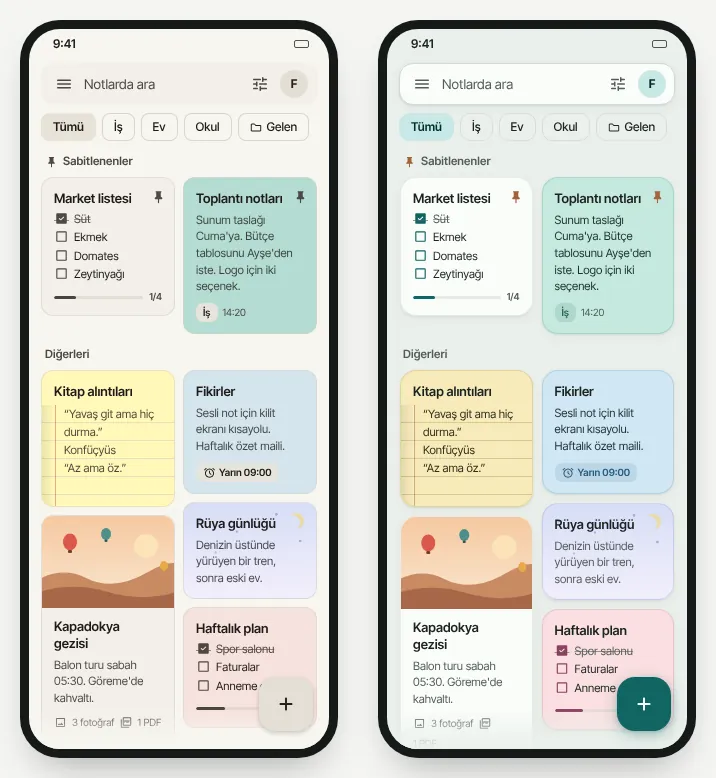
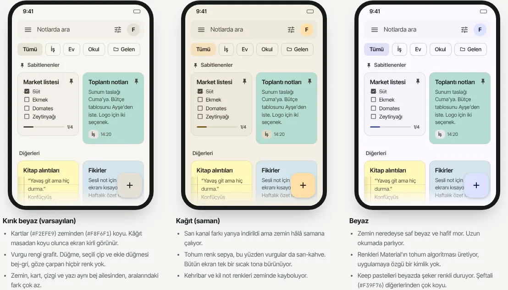
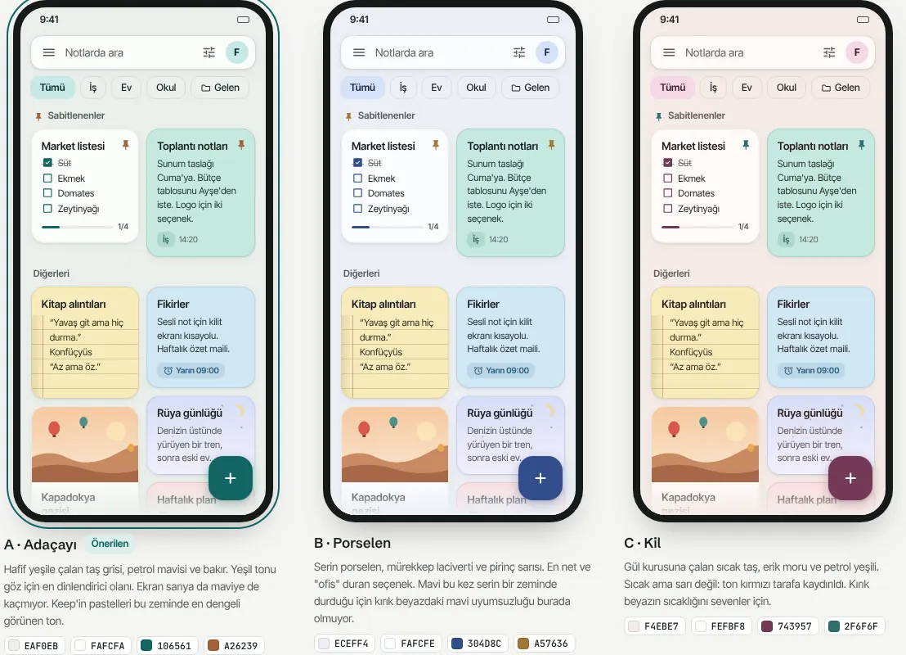
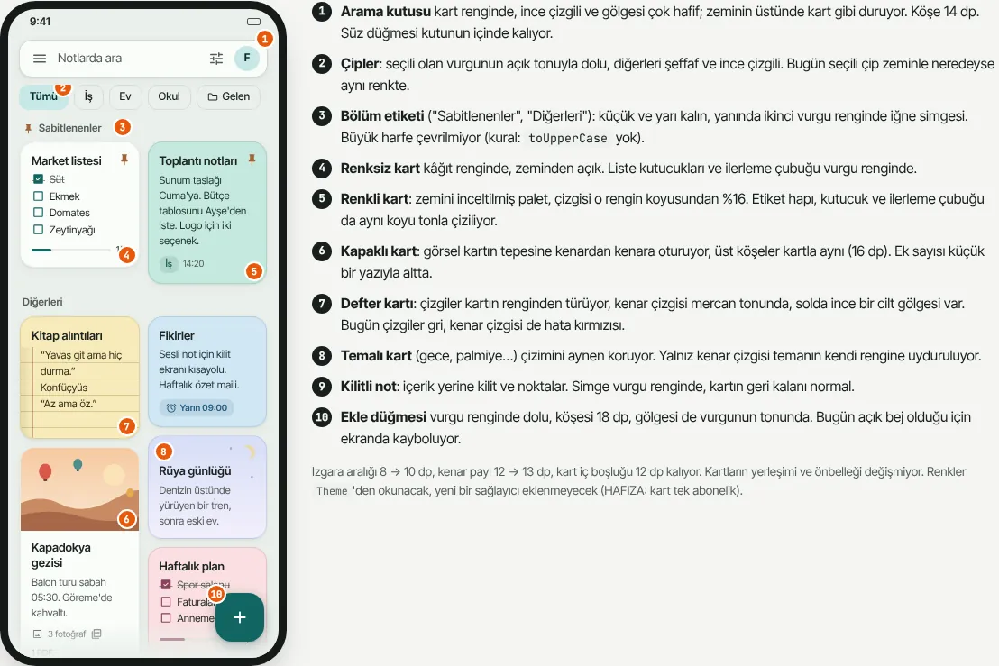
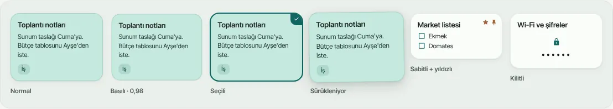
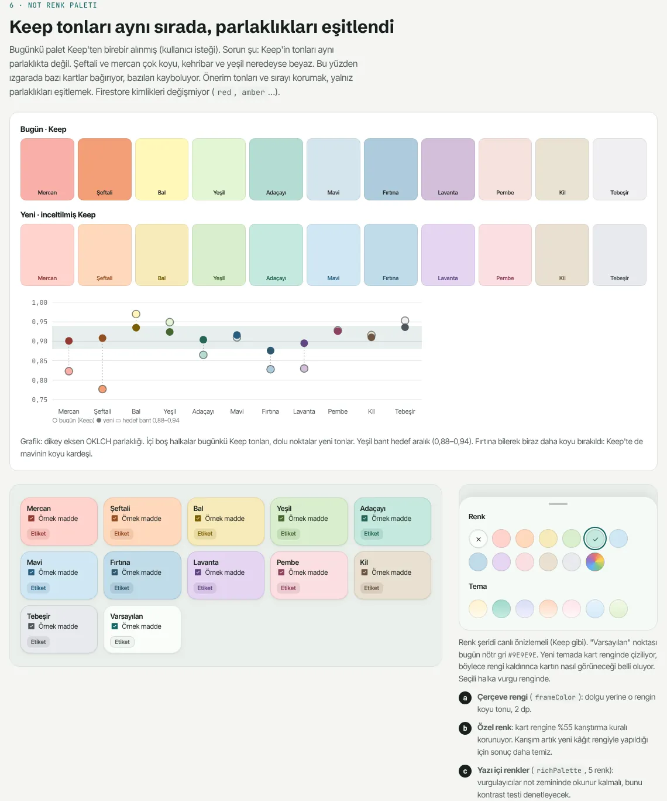
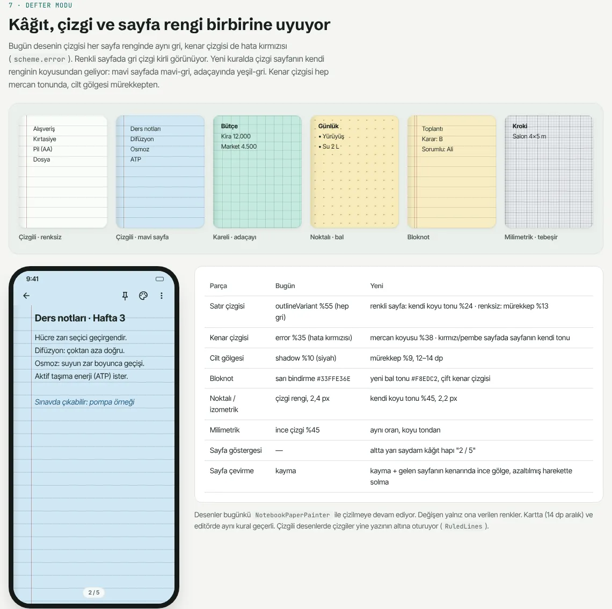
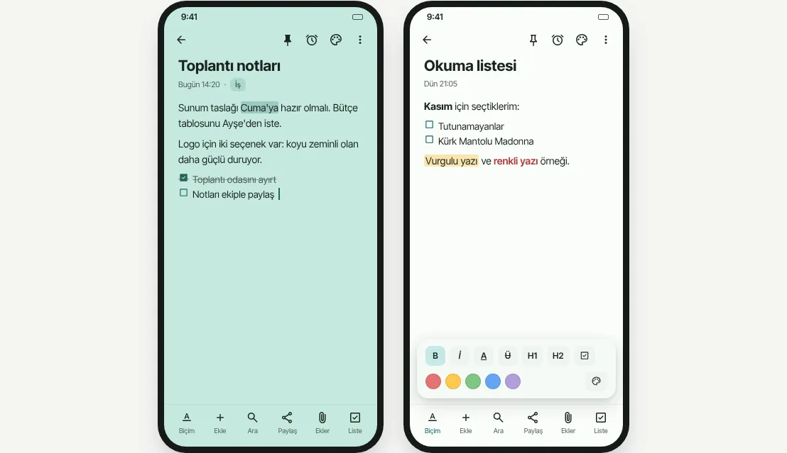
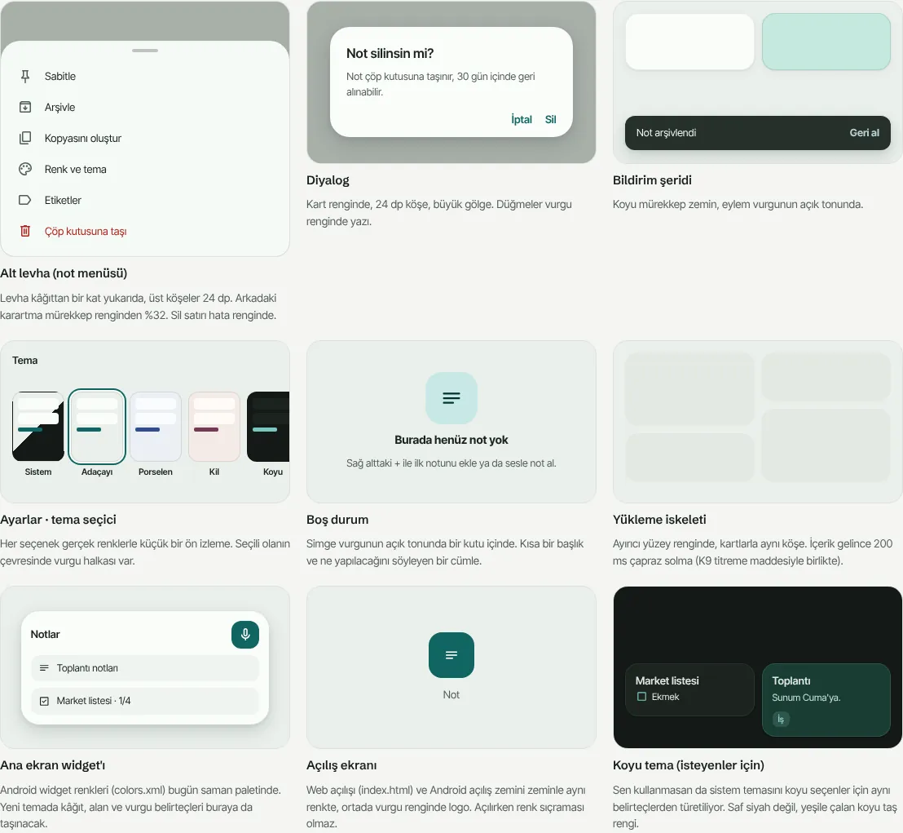

# TEMA PLANI — Faz 29–35 (yeni ana tema)

Kaynak: 2026-11-04 kullanıcı isteği: *"kırık beyaz soluk ve sıkıcı, saman çok
sarı, beyaz çok parlak, koyu temaları sevmiyorum; premium, herkesin rahatça
kullanacağı, sıkılmayacağı ama basit olmayan bir tema — defter modu, sayfa
renkleri, geçişler, kartların ana ekrandaki duruşu dahil her alan düşünülsün."*
Kod DEĞİŞTİRİLMEDİ; yalnız plan + örnek görseller.

**Örnek ekranlı plan (etkileşimli, "Bugün / A / B / C" seçicili):**
https://claude.ai/artifact/65R3jgaZoDWn32gkH7N7zQ — görsellerin durağan
kopyası `docs/tema/`. Numara `AKICILIK_PLANI.md` (Faz 20–27) ve
`KALAN_ISLER_PLANI.md` Faz 28 sonrasından başlar.

## Bu dosya nasıl kullanılır

Kullanıcı "Faz N'i yap" dediğinde (N = 29…35):

1. Bu dosyayı + HAFIZA.md'yi oku. Yalnız **Faz N**; kendiliğinden sonrakine geçme.
2. Sıra: **29 → 30 → (31, 32, 33 herhangi sırayla) → 34 → 35.** Faz 29 ve 30
   yapılmadan diğerlerine başlanmaz (hepsi belirteçlerden okur).
3. **Kararlar** bölümünde "AÇIK" kalan madde varsa önce kullanıcıya sor.
4. Satır numaraları 2026-11-04 hâlidir: önce `grep`, koddan doğrula.
5. **Akıcılık bütçesi bağlayıcı:** kart, geçiş ve gölge işleri `AKICILIK_PLANI.md`
   Faz 21 (kart) ve Faz 23 (geçiş, K7 GLES) ölçümlerini geriletemez. Kart başına
   yeni sağlayıcı/abonelik, tam ekran katman, kart başına animasyon YOK.
6. Faz sonunda değişenin testi oturumda + tam takım CI'da yeşil (CLAUDE.md ›
   DOĞRULAMA — KISA YOL; paylaşılan çekirdek olduğu için Faz 29–30'da tam takım
   oturumda da); maddeler `[x]` + **Yapıldı:** satırı; Durum tablosu; kalıcı
   karar/tuzak → HAFIZA.md; commit + push. Telefon gerektiren ölçüm:
   "yazıldı, cihazda doğrulanmadı" + `KALANLAR.md` §2.
7. Faz 34 `lib/app/note_open_route.dart`'a dokunur — akıcılık Faz 23 açıkken
   aynı dosyada çalışan başka oturum varsa önce onunla birleştir.

## Durum

| Faz | Konu | Durum | Tarih | Not |
|---|---|---|---|---|
| 29 | Altyapı: renk belirteçleri + kontrast testi | Yapıldı | 2026-11-04 | `AppTokens`, `app_palette.dart`, `theme_contrast_test`; F29.5 açık |
| 30 | Yeni tema: yüzeyler, vurgu, bileşenler, ayar, göç | Yapıldı | 2026-11-04 | cihazda doğrulanmadı (KALANLAR §2 #49) |
| 31 | Ana ekran ve not kartları | Kısmen | 2026-11-04 | kart, haplar, arama kutusu, FAB; ızgara aralığı/bölüm etiketi/iskelet açık; gölge ölçümü #50 |
| 32 | Not renk paleti ve not temaları | Kısmen | 2026-11-04 | palet + koyu tonlar + çerçeve + yazı içi renk; seçici "Varsayılan" noktası, ΔE testi açık |
| 33 | Defter modu | Kısmen | 2026-11-04 | çizgi/kenar/cilt/bloknot/nokta; sayfa göstergesi + PDF açık |
| 34 | Geçişler ve hareket | Kısmen | 2026-11-04 | not açma köşe 16 + mürekkep karartma; `AppMotion`, tema/renk geçişi açık |
| 35 | Platform kenarları, koyu tema, temizlik | Kısmen | 2026-11-04 | widget, açılış (Android + web), koyu tema, eski temalar, kılavuz; simge K6 gereği dokunulmadı |

**Okunurluk düzeltmesi (2026-11-04, kullanıcı bulgusu — plan dışı, Faz 32 ile
birlikte):** "not arka plan rengini değiştirince bazen yazı rengi sabit
kaldığı için okuma zorluğu oluyor." KÖK NEDEN 1: özel renk kâğıda sabit oranda
(%55/%35) karışıyor, yazı hep tema mürekkebinde kalıyordu — koyu renkler açık
temada gri-orta zemin veriyordu (her iki yazı rengi de < 3:1). KÖK NEDEN 2:
satır içi renkli yazı sabit renkteydi (sarı yazı açık zeminde ~1,6:1).
**Yapıldı:** `NoteColors.customSurface` (karışım yazıyla ≥ 4,5 değilse: tersi
yöndeki renkte rengi koru + zıt tema; değilse karışımı kâğıda doğru aç),
`NoteColors.inkThemeFor` → editör (`_editorInk`) + kart (`_cardInk`) +
çöp kutusu/sıralama karosu (`NoteInkScope`) zıt temada çizilir; renkli yazı
`RichTextTheme.background` → `readableOn` (≥ 4,5, ton korunur). Testler
`note_readability_test` (9 uç renk × 3 aile × 2 parlaklık). Zemin GÖRSELİ
(fotoğraf) üstündeki yazı bu kurala girmez — görselin rengi bilinmiyor
(açık soru).

## Teşhis (bugün neden tutmuyor)

- **Kırık beyaz** (`AppTheme.offWhite`, varsayılan): kart (`surfaceContainerLow`
  `#F2EFE9`) zeminden (`surface` `#F8F6F1`) KOYU → kâğıt masadan koyu, ekran
  kirli/bulanık. Vurgu grafit `#4A453F` → düğme, seçili çip, ekle düğmesi
  bej-gri; renk sinyali yok. Bütün roller aynı düşük doygunluklu bej aileden.
- **Kağıt** (`AppTheme.paper`): sarı yarıya indi ama zemin hâlâ saman; sepya
  tohum vurguları da sarı-kahve yapıyor.
- **Beyaz** (`AppTheme.light`): zemin ~saf beyaz, hafif mor (tohum `#4A5CCC`);
  Material'ın algoritmasından, kimliksiz; Keep pastelleri şeker renkli.
- **Not paleti** (Keep birebir): parlaklıklar eşit değil — OKLCH L 0,78 (şeftali)
  … 0,97 (bal). Izgarada bazı kartlar bağırıyor, bazıları kayboluyor.
- **Defter:** çizgi her sayfa renginde aynı gri (`outlineVariant` %55), kenar
  çizgisi hata rengi (`scheme.error` %35), cilt siyah gölge.

## İlke — "masa ve kâğıt"

Zemin (masa) orta açıklıkta ve hafif renkli (L ≈ 0,95; beyaz 1,00, kırık beyaz
0,97) → parlamaz. Kart (kâğıt) zeminden AÇIK (L ≈ 0,99) + çok hafif gölge.
Levha/menü bir kat üstte. **Bir serin vurgu** (dokunulacak: ekle, seçili, imleç)
+ **bir sıcak vurgu** (dikkat: sabitli, yıldız, hatırlatıcı). Yazı saf siyah
değil, zeminin tonunu taşıyan mürekkep. Her not rengi kendi **koyu tonunu**
taşır (hap, kutucuk, ilerleme, defter çizgisi o tondan).

## Üç yön

| Belirteç | A · Adaçayı (önerilen) | B · Porselen | C · Kil |
|---|---|---|---|
| zemin `surface` | `#EAF0EB` | `#ECEFF4` | `#F4EBE7` |
| kart `surfaceContainerLowest` | `#FAFCFA` | `#FAFCFE` | `#FEFBF8` |
| levha | `#F5F9F6` | `#F6F9FC` | `#FCF7F4` |
| alan (arama, giriş) | `#EFF4F0` | `#F0F4F8` | `#F8F1ED` |
| ayırıcı (iskelet) | `#DEE5DF` | `#E0E4EB` | `#EBE0DC` |
| ince çizgi `outlineVariant` | `#D1D8D2` | `#D2D8DF` | `#DFD3CE` |
| `outline` | `#7F8982` | `#808791` | `#91827D` |
| mürekkep `onSurface` | `#1B2420` | `#1A1F2A` | `#2B1E1E` |
| soluk mürekkep | `#535E59` | `#545B66` | `#695958` |
| vurgu `primary` | `#106561` petrol | `#304D8C` lacivert | `#743957` erik |
| `primaryContainer` / `on…` | `#C8E9E6` / `#002E2C` | `#D6E2F9` / `#142548` | `#F5D8E4` / `#3E1B2D` |
| ikinci vurgu `secondary` | `#A26239` bakır | `#A57636` pirinç | `#2F6F6F` petrol yeşili |
| `secondaryContainer` | `#FBE3D2` | `#FAE9CE` | `#CFEBEB` |
| `inverseSurface` / `on…` | `#26302B` / `#EEF4F0` | `#262B36` / `#EEF1F7` | `#33262A` / `#F8EEEC` |
| yazı/zemin kontrastı | 13,8 | 14,3 | 13,7 |
| vurgu/kart · beyaz/vurgu | 6,7 · 6,9 | 8,0 · 8,2 | 8,3 · 8,5 |

Koyu karşılık (A): zemin `#131916`, kart `#1C2420`, mürekkep `#DFE7E2`, soluk
`#9FA7A2`, vurgu `#78C8C1`, ikinci vurgu `#E5A27A`. Değerler OKLCH'ten
türetildi; kontrastlar WCAG 2.1 formülüyle hesaplandı (F29.4 testi aynı
formülü kodda tekrar eder).

## Kararlar

Önerilenler **kalın**. **KARAR (kullanıcı, 2026-11-04): hepsi önerildiği gibi** ("önerilerinle beraber uygula").

- **K1 — Varsayılan tema:** **A · Adaçayı** / B · Porselen / C · Kil. — **KARAR: önerilen**
- **K2 — Eski açık temalar:** **kaldır + bir kez eşle (Kırık beyaz → A, Beyaz
  → B, Kağıt → C; Koyu ve Sistem kalır; üç yeni aile Ayarlar'da seçilebilir)** /
  "Klasik" başlığında bir sürüm daha tut. — **KARAR: önerilen**
- **K3 — Ayrı vurgu rengi seçimi:** **hayır, şimdilik** (her ailenin kendi
  vurgu çifti; kombinasyon/test yükü katlanır) / evet, 5 hazır vurgu. — **KARAR: önerilen**
- **K4 — Kart gölgesi:** **yumuşak iki katlı gölge, telefonda ölçümle;
  bütçeyi aşarsa bulanıksız 1 dp alt çizgi** / baştan gölgesiz. — **KARAR: önerilen**
- **K5 — Not paleti:** **inceltilmiş Keep (aynı ton/sıra/kimlik, eşit
  parlaklık, her rengin koyu tonu)** / Keep olduğu gibi (yalnız koyu tonlar
  eklenir). Not: palet daha önce kullanıcı isteğiyle Keep'e dönmüştü
  (`note_colors.dart`) — bu yüzden tonlar ve sıra korunuyor. — **KARAR: önerilen**
- **K6 — Uygulama simgesi:** **şimdilik dokunma** (saman paletinde kalır) /
  Faz 35'te `tool/gen_icon.py` ile yeni paletle üret. — **KARAR: önerilen**

---

## FAZ 29 — Altyapı: renk belirteçleri ve kontrast testi

Görünür değişiklik YOK: bugünkü temalar aynı piksellerle çizilir.

- [x] **F29.1 `AppTokens`** (`lib/app/theme/app_tokens.dart`,
  `ThemeExtension<AppTokens>` + `lerp`): zemin, kart, levha, alan, ayırıcı,
  ince çizgi, mürekkep, soluk mürekkep, iki vurgu (+ kapları), gölge listesi,
  kart köşesi, kart iç boşluğu, ızgara aralığı. Okuma `context.tokens`
  (`Theme.of` üstünden — yeni sağlayıcı yok).
  **Yapıldı:** `lib/app/theme/app_tokens.dart` (aile, yazı tipi, kart, çizgi, gölge, köşe; uzantısız temada şemadan türetir).
- [x] **F29.2 Tema ailesi tablosu:** `AppTheme._base` içindeki
  `if (offWhite) / if (paper) / if (isDark)` `copyWith` dalları yerine
  `ThemeFamily` kaydı (açık + koyu belirteç kümesi). Bugünkü aileler birebir
  taşınır (piksel değişmez). Önbellek anahtarı `aile|parlaklık|font`
  (`_cache` sınırı yeniden hesaplanır, yorum güncellenir).
  **Yapıldı:** `app_palette.dart` (`ThemeFamily`, `FamilyPalettes`); `AppTheme.of(aile, parlaklık, font)`, `AppTheme.opposite`. Eski aileler TAŞINMADI, kaldırıldı (K2).
- [x] **F29.3 `NoteColors` aileye bağlanır:** her `NoteColor` için zemin +
  koyu ton (`ink`) + defter çizgi tonu; `_light/_dark` statik haritaları
  aileden gelir. Kimlikler (`red`, `amber`…) DEĞİŞMEZ (Firestore). `swatch`
  bağlamsız kullanımları gözden geçir.
  **Yapıldı:** `NoteColors` açık/koyu palet + koyu tonlar (`ink`, `noteInk`, `marginInk`); kimlikler aynı.
- [x] **F29.4 `test/theme_contrast_test.dart`:** her aile (açık+koyu) için
  mürekkep/zemin ve mürekkep/kart ≥ 4,5; soluk mürekkep/kart ≥ 4,5; vurgu ve
  ince çizgi/kart ≥ 3; `onPrimary`/vurgu ≥ 4,5; her not renginde mürekkep ≥ 4,5
  ve koyu ton ≥ 4,5. (Bugünkü ailelerde başarısız olan varsa testte "bilinen"
  olarak işaretle, yeni ailelerde kural kesin.)
  **Yapıldı:** `test/theme_contrast_test.dart` (+ `accessibility_test` F15.6 bütün ailelere genişledi).
- [ ] **F29.5 `visual_consistency_test` genişlet:** kart yarıçapı
  (`BorderRadius.circular(12)` kart dosyalarında) ve kart/zemin renkleri
  belirteçten okunur; sabit renk yalnız `fixed_colors.dart` kuralı korunur.
- Kabul: tam takım yeşil, altın/ekran görüntüsü testi bugünkü temalarda fark
  göstermez.

## FAZ 30 — Yeni tema: yüzeyler, vurgu, bileşenler (K1, K2, K3)

- [x] **F30.1** Seçilen yön(ler)in ailesi (açık + koyu) `ThemeFamily` olarak;
  `AppThemeChoice`'a yeni değer(ler), `effectiveThemeModeProvider` eşlemesi.
  **Yapıldı:** `AppThemeChoice {system, sage, porcelain, clay, dark}` + `family`; koyu kip seçili ailenin koyusunu kullanır.
- [x] **F30.2 Bileşen temaları** (hepsi belirteçten): `AppBarTheme` (zemin
  rengi, `scrolledUnderElevation: 0`, kaydırınca ince alt çizgi),
  `CardThemeData` (kart rengi, 16 köşe, ince çizgi), `ChipThemeData` (seçili =
  `primaryContainer`; seçisiz = şeffaf + ince çizgi; köşe 10),
  `InputDecorationTheme` (alan rengi), `FloatingActionButtonThemeData`
  (**`primary` dolgu**, köşe 18), `BottomSheetThemeData` (levha rengi, üst
  köşe 24, tutamak mürekkep %25, karartma mürekkep %32), `DialogTheme` (kart,
  24), `PopupMenuTheme`/`MenuTheme` (kart + gölge), `SnackBarThemeData`
  (`inverseSurface`), `Switch/Checkbox/Radio/Slider`, `ProgressIndicator`,
  `Tooltip`, `NavigationRailTheme` (web), `DividerTheme`, `ListTileTheme`
  (seçili = ayırıcı), `TextSelectionTheme` (vurgu %24, imleç vurgu),
  `ScrollbarTheme`, `SegmentedButtonTheme`, `BadgeTheme`.
  **Yapıldı:** `AppTheme._base` (arama çubuğu, gezinme çubuğu, çekmece, ilerleme dahil). Kaydırınca alt çizgi YAPILMADI (scrolledUnderElevation 0).
- [x] **F30.3 Yazı:** Inter Tight varsayılan kalır; başlık 600, soluk metin
  ve meta renkleri belirteçten (`appFontTextTheme` üstüne renk katmanı).
  **Yapıldı:** `textTheme.apply(bodyColor/displayColor: mürekkep)`.
- [x] **F30.4 Ayarlar → Görünüm** (`settings_appearance.dart` `_ThemeSelector`):
  yeni aile kartları (gerçek renklerle mini önizleme), K3'e göre vurgu satırı.
  l10n anahtarları (tr + en).
  **Yapıldı:** `_ThemeCard` önizlemesi zemin + kâğıt kart + çizgi; vurgu satırı yok (K3).
- [x] **F30.5 Göç (K2):** kayıtlı `theme_mode` = `offWhite/light/paper` bir
  kez yeni ailelere eşlenir (`theme_family_migrated` bayrağı); `orElse` yeni
  varsayılan. Eski değer okunmaya devam eder (geri dönüş mümkün). Test.
  **Yapıldı:** `AppThemeChoice.fromStored` okurken eşler, kayda yazmaz (bayrak gerekmedi; eski sürüm eski adı okumaya devam eder). Test `theme_default_test`.
- [ ] **F30.6** Durum/gezinme çubuğu (`SystemUiOverlayStyle`) zemin renginde,
  simgeler koyu.
- Kabul: her aile için ayarlar, ana ekran, not ekranı altın görüntüsü; kontrast
  testi yeşil; `perf_test` bütçesi yeşil.

## FAZ 31 — Ana ekran ve not kartları (K4)

- [x] **F31.1 Kart zemini/kenarı** (`note_card.dart`, `dashboard_widgets.dart`,
  `NoteListRow`): renksiz kart = kart rengi (zeminden açık), renkli = palet;
  köşe 12 → 16 (kapak, defter kırpması, `NoteOpenOrigin.register(radius:)` dahil);
  kenar 1 dp sabit — renksiz: mürekkep %8, renkli: kendi koyu tonu %16 (seçimde
  kalınlaşmaz — 2026-08-09 kayma kök nedeni).
  **Yapıldı:** `note_card.dart` (köşe `AppTokens.cardRadius`, açılış geçişi dahil), sıralama karosu, liste satırı 14.
- [x] **F31.2 Gölge (K4):** `0 1 2 /%6` + `0 3 10 /%5` mürekkep tonunda.
  **Ölçüm kapısı:** telefonda kaydırma raster p90 ≤ 9 ms (bugün 8,6, AKICILIK
  K7 GLES). Aşarsa bulanıksız 1 dp alt çizgi yedeği. Cihazda doğrulanmadıysa
  yedek varsayılan, gölge bayrakla.
  **Yapıldı (yedek):** bulanıksız 1 dp alt kenar varsayılan; yumuşak gölge ölçüm bekliyor (KALANLAR §2 #50).
- [x] **F31.3 Kart yazısı ve haplar:** başlık 15/600 mürekkep; önizleme
  13,5/1,45 soluk mürekkep (renkli kartta rengin tonuna karışır); etiket,
  klasör (`_FolderBadge`), hatırlatıcı hapı ve ilerleme çubuğu
  (`_ChecklistProgress`) kartın koyu tonuyla; renksiz kartta alan rengi + ince
  çizgi. Kartta ≥ 12 punto ve < 0,8 alfa yok kuralı.
  **Yapıldı:** pin/yıldız ikinci vurgu, etiket/klasör/kutucuk/ilerleme kartın koyu tonu (`_CardAccent`).
- [ ] **F31.4 Durumlar:** basılı (0,98 `Transform`, 100 ms), seçili (2 dp vurgu
  halkası + köşede onay rozeti — boya katmanı), sürükleniyor (1,03 + büyük
  gölge + −0,8° — yalnız sürüklenen kart), kilitli/hassas, sabitli (ikinci
  vurgu iğne), yıldız (ikinci vurgu).
- [ ] **F31.5 Üst bölge:** arama kutusu kart renginde + ince çizgi, köşe 14;
  çipler (F30.2); bölüm etiketleri "Sabitlenenler/Diğerleri" 11,5/600 soluk
  mürekkep, iğne ikinci vurguda (`toUpperCase` YOK); ızgara aralığı 8 → 10,
  kenar payı 12 → 13 (`dashboard_slivers.dart`, `dashboard_shelf.dart`,
  satır 1032 hesabı).
  **Kısmen (2026-11-04, TUTARLILIK F36.7):** bölüm etiketleri cümle düzeninde
  ("Sabit · Bugün · Bu hafta · Daha önce") ve uygulamanın TEK başlık
  bileşeniyle (`SectionLabel`, levha başlıklarıyla aynı boy/renk) — 11,5/soluk
  yerine bilerek (tek bileşen ilkesi). Sayının yeri TUTARLILIK F39.1.
- [x] **F31.6 Hızlı ekle** (`quick_add_fab.dart`): `primary` dolgu, açılan menü
  levha rengi.
  **Yapıldı:** FAB teması `primary` dolgu.
- [ ] **F31.7 Boş durum ve iskelet** (`EmptyState`, `NoteListSkeleton`) yeni
  tonlarla; iskelet → içerik 200 ms çapraz solma (AKICILIK K9 ile birlikte).
- [ ] **F31.8 Ana ekran zemini** (`dashboard_pattern.dart`,
  `dashboard_background_sheet.dart`): desen rengi mürekkepten; görsel zeminde
  kartlar opak kalır.
- Kabul: `perf_test` yeşil; kart önbelleği + `_cardEnvProvider` tek abonelik
  bozulmaz; telefonda kaydırma ölçümü KALANLAR §2.

## FAZ 32 — Not renk paleti ve not temaları (K5)

İnceltilmiş Keep (açık tema; OKLCH L 0,88–0,94):

| Kimlik | Ad | Bugün (Keep) | Yeni zemin | Koyu ton (ink) | Koyu tema |
|---|---|---|---|---|---|
| `red` | Mercan | `#FAAFA8` | `#FFD2CD` | `#923B33` | `#502825` |
| `peach` | Şeftali | `#F39F76` | `#FFD8BD` | `#944E21` | `#4D2C15` |
| `amber` | Bal | `#FFF8B8` | `#F7EAB9` | `#7B5F06` | `#41340A` |
| `green` | Yeşil | `#E2F6D3` | `#D8EECD` | `#446630` | `#273C23` |
| `sage` | Adaçayı | `#B4DDD3` | `#C4E9DE` | `#246556` | `#193D34` |
| `blue` | Mavi | `#D4E4ED` | `#D1E7F4` | `#285D80` | `#1B394C` |
| `storm` | Fırtına | `#AECCDC` | `#C0DBE9` | `#2F586F` | `#233845` |
| `purple` | Lavanta | `#D3BFDB` | `#E5D5F2` | `#624581` | `#3C2E4C` |
| `blossom` | Pembe | `#F6E2DD` | `#FADFE0` | `#8C4061` | `#4A2A37` |
| `clay` | Kil | `#E9E3D4` | `#E9E0D1` | `#6D5640` | `#3E3327` |
| `chalk` | Tebeşir | `#EFEFF1` | `#E7EAED` | `#50565E` | `#343539` |

Koyu temada koyu ton yerine açık ton (ör. adaçayı `#94D6C4`) — artifact
kaynağında `data-dir="Ad"` kümesi. Pembe mercandan ayrışsın diye ton 34° →
15°'ye kaydırıldı.

- [x] **F32.1** Palet + koyu tonlar aile tablosunda (F29.3); kimlik/sıra aynı.
  **Yapıldı.**
- [ ] **F32.2 Renk şeridi** (`color_picker_sheet.dart`, `color_palette.dart`):
  "Varsayılan" noktası kart renginde (bugün `#9E9E9E`), seçili halka vurgu.
- [x] **F32.3 Çerçeve** (`noteFrame`) koyu tondan 2 dp; **özel renk** karışımı
  (%55 açık / %35 koyu) yeni kart rengiyle — sonucu kontrast testine kat.
  **Yapıldı:** `noteFrame(note, dark:)` koyu ton; özel renk `customSurface` (okunurluk kuralıyla).
- [x] **F32.4 Yazı içi palet** (`richPalette`, 5 renk): her not renginde vurgu
  ve renkli yazı okunur (test).
  **Yapıldı:** `markStyle(background:)` + `readableOn`.
- [x] **F32.5 Not temaları** (`note_themes.dart`): açık tonlar yeni zeminde
  gözden geçirilir; gerekirse yalnız `NoteThemePalette` tonu, çizimler aynı.
  Kartta kenar çizgisi temanın `art` renginden.
  **Yapıldı:** temaların düz zemini kontrast testinde; ton değişikliği gerekmedi.
- [ ] **F32.6 Erişilebilirlik:** `lib/core/a11y/color_names` yeni adlar (tr+en);
  komşu tonlar arasında ΔE(OK) ≥ 0,08 testi (renk körlüğü ayrımı).
- Kabul: kontrast + ayrım testleri yeşil; eski kayıtlı not aynı kimlikle açılır.

## FAZ 33 — Defter modu

- [x] **F33.1 Çizgi rengi sayfadan:** `NotebookPaper` / `_withCardPaper`
  `line:` = renkli sayfada koyu ton %24, renksizde mürekkep %13 (bugün
  `outlineVariant` %55/%60). `RuledLines` aynı rengi alır.
  **Yapıldı:** `PaperInks` (editör `NotebookPaper(accent:)` + `RuledLines`, kart `_withCardPaper`).
- [x] **F33.2 Kenar çizgisi:** `scheme.error` %35 yerine mercan koyusu %38;
  kırmızı/pembe sayfada sayfanın kendi koyu tonu.
  **Yapıldı.**
- [x] **F33.3 Cilt gölgesi** `scheme.shadow` yerine mürekkep %9.
  **Yapıldı.**
- [x] **F33.4 Bloknot:** `legalTint` yeni bal tonu (`#F8EDC2`), çift kenar.
  **Yapıldı:** `legalTint` `0x3DF2D774`.
- [x] **F33.5 Noktalı/izometrik** nokta rengi koyu ton %45; kareli %16;
  milimetrik ince çizgi oranı korunur. Kart (14 dp) ve editör aynı kural.
  **Yapıldı:** nokta rengi çizginin 1,7 katı alfa.
- [ ] **F33.6 Sayfa göstergesi + çevirme** (`page_swipe.dart`): altta yarı
  saydam kâğıt hapı "2 / 5"; geçişte gelen sayfa kenarında ince gölge;
  azaltılmış harekette solma.
- [ ] **F33.7 PDF dışa aktarım** (`pdf_export_screen.dart`): defter deseni
  aynı renklerle (varsa).
- Kabul: altın görüntü her desen × 3 sayfa rengi; `RuledLines` yazı-çizgi testi
  değişmeden yeşil.

## FAZ 34 — Geçişler ve hareket

| Belirteç | Süre | Eğri | Nerede |
|---|---|---|---|
| anlık | 100 ms | standart `(0.2,0,0,1)` | kart basma, düğme, kutucuk |
| kısa | 200 ms | standart | not rengi, çip, simge, seçim halkası |
| orta | 300 ms | giriş `(0.05,0.7,0.1,1)` · çıkış `(0.3,0,0.8,0.15)` | levha, menü, diyalog, tema, süzgeç |
| uzun | 460/380 ms (not), 420/360 (ekran) | vurgulu | bugünkü süreler korunur |
| azaltılmış | ≤ 150 ms | doğrusal solma | `motionOf` kapalı |

- [ ] **F34.1 `AppMotion`** (süre + eğri) `app_tokens.dart`'ta; en sık sabit
  süreler bağlanır, gerisine dokunulmaz (toplu değişiklik yok).
- [x] **F34.2 Not açma/kapama** (`note_open_route.dart`): köşe 16 → 0,
  karartma siyah yerine mürekkep tonunda; içerik t ≈ 0,45 sonrası belirir;
  F23.4 görüntü/boya alfası yöntemi KORUNUR. Raster ölçümü KALANLAR §2 #42 ile.
  **Yapıldı:** varsayılan yarıçap 16, kart kendi köşesini verir; karartma `scheme.scrim` (açıkta mürekkep). Görüntü yöntemi aynı.
- [ ] **F34.3 Tema değişimi:** `themeAnimationDuration` 300 ms +
  `easeInOutCubic`. ÖNCE ölç: `AnimatedTheme` her karede `ThemeData.lerp` +
  tam ağaç kurulumu. Pahalıysa `Duration.zero`.
- [ ] **F34.4 Not rengi değişimi** 200 ms (editör zemini + kart).
- [ ] **F34.5** Kart basma/seçme/sürükleme (F31.4 ile aynı madde, tek yerde).
- [ ] **F34.6** Levha, menü, diyalog aynı eğri; süzgeç/segment değişiminde
  solma (F26.4 tek ızgara kuralı korunur). Kartlara kademeli giriş animasyonu
  EKLENMEZ (titreme + maliyet).
- [ ] **F34.7** Azaltılmış hareket testi (`motionOf` false → süreler ≤ 150 ms).
- Kabul: AKICILIK Faz 23 ölçümleri gerilemez; geçişte raster < 12 ms hedefi.

## FAZ 35 — Platform kenarları, koyu tema, temizlik (K2, K6)

- [x] **F35.1 Android widget** renkleri (`android/app/src/main/res/values*/colors.xml`
  — bugün saman paleti `#F5EDD8`/`#7D5703`) yeni aileden; gece karşılığı.
  **Yapıldı:** values + values-night (Adaçayı); simge renkleri aynı.
- [x] **F35.2 Açılış:** `web/index.html` açılış değişkenleri + `theme-color`
  metası, `web/manifest.json` (`background_color` `#F3EFE3`, `theme_color`
  `#13254A` → yeni), Android açılış zemini, bildirim vurgu rengi.
  **Yapıldı:** `launch_background.xml` → `@color/launch_bg`; `web/index.html` değişkenleri + `theme-color`; `manifest.json`.
- [x] **F35.3 Simge (K6).**
  **K6 gereği yapılmadı** (simge saman paletinde).
- [x] **F35.4 Koyu tema** aynı belirteçlerden + koyu not paleti; kontrast testi.
  **Yapıldı:** her ailenin koyusu `app_palette.dart` içinde, kontrast testinde.
- [x] **F35.5 Eski temalar (K2):** kaldırma ya da "Klasik"; l10n, kılavuz
  (`assets/guide/guide_<dil>.md`, `guide_screen_test` eskimiş ifade listesi),
  `STORE_LISTING.md` görselleri.
  **Yapıldı:** l10n `themeSage/Porcelain/Clay` (eski üç anahtar silindi), kılavuz (tr+en).
- [x] **F35.6 Telefonda duman testi** KALANLAR §2'ye: tema değiştir, ana ekranı
  kaydır (raster), not aç/kapa, renk değiştir, defter sayfası çevir, widget,
  açılış ekranı.
  **Yapıldı:** KALANLAR §2 #49–#53.
- Kabul: CI yeşil, kişisel APK telefonda gözle kontrol.
