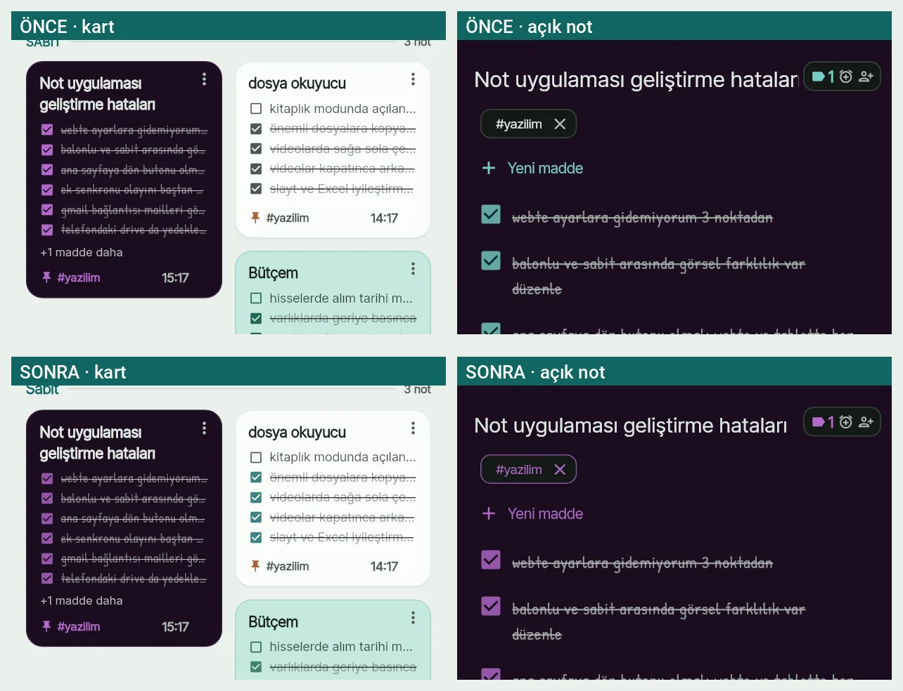
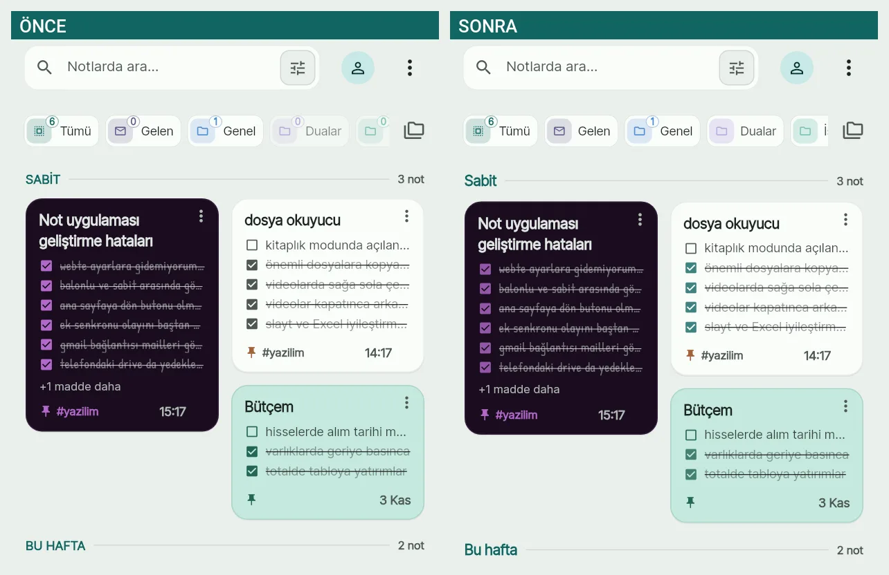
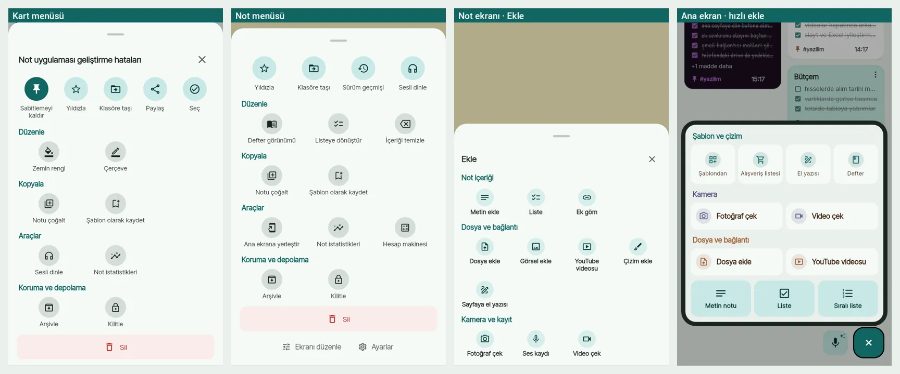
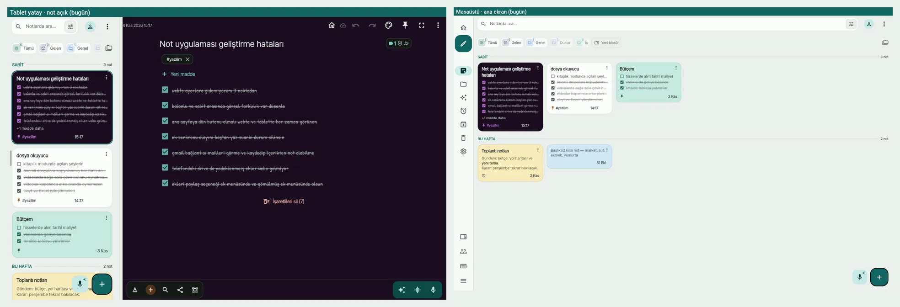

# TUTARLILIK PLANI — Faz 36–45 (görsel birlik, işlevsel tutarlılık, akış)

Kaynak: 2026-11-04 kullanıcı isteği, üç ekran görüntüsüyle (telefon: ana ekran
+ koyu renkli not; web/telefon: "dosya okuyucu" notu + yapay zekâ hatası):

> *"Notun açık hali ile dashboarddaki görüntüsü farklı. Tüm ekranlarda görülen
> butonlar, yazılar, tuşlar — etkileşimli olan olmayan bütün işlevler arasında
> görsel birlik, işlevsel tutarlılık ve doğruluk; yerlerinin en doğru,
> kullanışlı ve güzel konumda olması; eklerin doğru işlenmesi ve gösterilmesi;
> kişilerin çalışma akışı, not alma, ekler üzerinde çalışma ve düzenleme; eklerin
> sabit, serbest, yazıya gömülü, balonlu hâli; videolar; menülerin işlevselliği,
> doğruluğu ve gereksiz fazlalık olmaması; bütün modların tutarlılığı. Klasörler,
> süzgeçler, kaydırarak klasör geçişi, iki parmak zoom, araçlar, yapay zekâ,
> sesle yazma (AI'lı / AI'sız), paylaşım, Gelen / benimle paylaşılanlar…
> Her şey eklenebilir, çıkarılabilir, değiştirilebilir, sadeleştirilebilir,
> birleştirilebilir, baştan tasarlanabilir. Web ve tablet düzenleri de.
> Performans geliştirmeleri bozulmasın, kasmaya dikkat."*

Numara `TEMA_PLANI.md` (Faz 29–35) sonrasından başlar. **Faz 36 bu oturumda
yapıldı** (aşağıda `[x]`); Faz 37–45 sıradaki oturumların işi.

## İnceleme nasıl yapıldı

- **Kullanıcının üç ekran görüntüsü** (etiket **E**).
- **Ekran turu aracı** (yeni, `tool/tour/screen_tour_test.dart`, etiket **T**):
  gerçek ana ekran, not ekranı ve menüleri Firebase'siz sahte verilerle
  **telefon 412×915 · tablet dikey 800×1280 · tablet yatay 1280×800 · masaüstü
  1440×900** boyutlarında çizer, PNG yazar (`build/tour/`). Yazı tipleri ve
  simgeler gerçek; gölgeler testte düz çizgi (debugDisableShadows) — FAB/panel
  çevresindeki koyu halka GERÇEK DEĞİL. Canlı sitede misafir hesap açmadan web
  ve tablet düzeni görülebiliyor. Kullanım:
  `flutter test tool/tour/screen_tour_test.dart` (süz: `TOUR_ONLY=ana,n1-menu`,
  koyu: `TOUR_DARK=1`, çıktı: `TOUR_OUT=...`). CI'da koşmaz (test/ dışında).
- **Kod okuması** (etiket **K**, dosya:satır 2026-11-04 hâli — önce `grep`).
- **Cihaz yok** (telefon/tablet bu ortamda değil): yalnız cihazda görülebilenler
  **C** etiketli; adımlar `KALANLAR.md` §2 (#54–) ve Faz 45'te.

## Bu dosya nasıl kullanılır

Kullanıcı "Faz N'i yap" dediğinde (N = 37…45) ya da "F40.3'ü yap" (tek madde):

1. Bu dosyayı + HAFIZA.md'yi oku. Yalnız **Faz N**; kendiliğinden sonrakine geçme.
2. **Kararlar** bölümünde (şu an AÇIK madde yok: K1–K10 onaylı) "AÇIK" kalan madde o fazı ilgilendiriyorsa önce sor
   (gece görevi: en güvenli seçenek + "sabah bakılacak").
3. Satır numaraları 2026-11-04 hâli: önce `grep`, bulguyu koddan (ve turdan)
   yeniden DOĞRULA; geçersizse `GEÇERSİZ: neden` yaz.
4. **Akıcılık bütçesi bağlayıcı** (`AKICILIK_PLANI.md` Faz 21/23/24/26, TEMA
   kuralı 5): kart başına yeni sağlayıcı/abonelik YOK (`_cardEnvProvider` tek
   abonelik), `Opacity`/`saveLayer`/kart başına animasyon YOK, geçiş ağacı her
   karede aynı yapı, Hero yürüyüşü kapalı kalır (`withoutHeroWalk`), satır
   önbelleği (`_cachedItemRow`) anahtarına yeni görünür alan. Ölçüm isteyen
   madde: önce ölç (`tool/perf/`, CI `[perf]`), sonra değiştir.
5. Her madde: değişiklik + test (kırmızıdan yeşile) + mümkünse tur görüntüsü
   (önce/sonra). Metin değişikliği `app_tr.arb` + `app_en.arb` → `flutter
   gen-l10n` + `dart format lib/l10n/generated`; kılavuz etkileniyorsa
   `assets/guide/guide_tr.md` + `_en.md`.
6. Faz sonunda değişenin testi oturumda, tam takım CI'da yeşil (CLAUDE.md ›
   DOĞRULAMA); maddeler `[x]` + **Yapıldı:** satırı; Durum tablosu; kalıcı
   karar/tuzak → HAFIZA.md; telefon isteyen → "yazıldı, cihazda doğrulanmadı"
   + `KALANLAR.md` §2.
7. `UiItem.*` kimlikleri kalıcı tercih anahtarı: düğme taşırken kimliği değiştirme.

## Durum

| Faz | Konu | Durum | Tarih | Not |
|---|---|---|---|---|
| 36 | Kırık ve tutarsız olanlar (hemen) | Yapıldı | 2026-11-04 | 9/9; cihazda doğrulanmadı (KALANLAR §2 #54–#58) |
| 37 | Not her yerde aynı görünür | Yapıldı | 2026-11-05 | 5/5; KALANLAR §2 #62–#65 |
| 38 | Not ekranı: çubuklar, başlık satırı, tek not menüsü | Yapıldı | 2026-11-05 | 7/7; F38.7 birikim yok (kod değişmedi), Biçim paneli başlığı GEÇERSİZ; KALANLAR §2 #66–#69 |
| 39 | Ana ekran: başlık, çipler, bölümler, jestler | Yapıldı | 2026-11-05 | 6/6; F39.4 GEÇERSİZ; KALANLAR §2 #70 |
| 40 | Ekler: tek model, tek menü | Yapıldı | 2026-11-05 | 9/9; Android tablette sürükle-bırak yok (motor), videoda dönüş oturumluk, tur F45.1'e; KALANLAR §2 #71–#74 |
| 41 | Ekleme akışı ve şablonlar | Yapıldı | 2026-11-05 | 4/4; paylaşım hedef levhası korundu; KALANLAR §2 #75–#76 |
| 42 | Yapay zekâ ve ses: tek dil, görünür durum | Yapıldı | 2026-11-05 | 6/6; cihazda elle doğrulanmadı, KALANLAR §2 #77–#80 |
| 43 | Paylaşım, Gelen, benimle paylaşılanlar | Açık | | K8 |
| 44 | Web ve geniş ekran (tablet, masaüstü) | Açık | | K3, K4, K5 |
| 45 | Ölçüm, tur, kural testleri, cihaz turu | Açık | | tur aracı genişler |

## İlkeler — "bir şey, bir görünüş, bir ad, bir yer"

1. **Not her yerde aynı görünür.** Kart, notun küçük kopyasıdır: zemin, yazı
   tipi, kutucuk, etiket, raptiye, vurgu rengi AYNI kaynaktan (`NoteAccent`,
   `NoteCheckColors`, `NoteColors.noteSurface`). Liste satırı, widget, paylaşım
   görseli, çöp/arşiv kartı da.
2. **Bir iş = bir ad + bir simge + bir yer.** Ad `TERIMLER.md`'de, simge
   `AppIcons`'ta; aynı iş farklı menülerde aynı adla ve aynı sırada durur.
   Eşanlamlı ("Sayfaya göm" / "Sayfaya geri koy" / "Nota aktar") yok.
3. **Ek tek model.** Her ek, her görünümde (şerit · sabit · yüzen · balonlu ·
   yazıya gömülü · görüntüleyici) aynı işlem listesini aynı sırayla sunar;
   görünüme özgü araçlar (genişlik, oynatma, sayfa) ayrı satırda.
4. **Krom uygulamanın, içerik notun.** Çubuklar, levhalar, menüler uygulama
   temasında; sayfa, kutucuk, haplar, raptiye notun renginde.
5. **Tek bileşen.** `SectionLabel`, `SheetHeader`, `ActionMenu`, çip gövdesi,
   `EmptyState`, `NoteListSkeleton`… kopya bileşen yazılmaz; kural testle korunur.
6. **Sayı yoksa rozet yok;** boş durum tek satır açıklama + tek eylem.
7. **Hata metni tek cümle:** ne oldu + ne yapılır. Arka plan işi (otomatik
   başlık/etiket, jest) kullanıcıyı hata yağmuruna tutmaz: bir kez, bağlamında.
8. **Geniş ekran telefonun büyütülmüşü değil:** içerik okuma sütununda,
   araçlar onunla hizalı; her dokunmatik jestin fare/klavye/dokunmatik yüzey
   karşılığı var.
9. **Akıcılık bütçesi** (yukarıda, protokol 4).
10. **Her kural bir testle** (tur aracı + birim/arayüz testi).

---

## Bulgu envanteri

Değerlendirme: 🔴 kırık/yanıltıcı · 🟡 tutarsız/eksik · 🟢 iyi (cila).

### A. Kart ↔ açık not (görsel birlik)

| # | Bulgu | Kanıt | Öneri | Faz |
|---|---|---|---|---|
| A1 🔴 | Renkli notta kutucuk, etiket, raptiye kartta notun koyu tonuyla (pembe), editörde temanın vurgusuyla (petrol yeşili) — kullanıcının bulgusu | E, T; K `note_card.dart` `_CardAccent` (F31.3), `items_editor_row.dart` `scheme.primary` | tek `NoteAccent` | **F36.1 ✓** |
| A2 🟡 | Renksiz notta kart kutucuğu gri, editörde petrol yeşili dolu | T | aynı kural (`NoteCheckColors`) | **F36.1 ✓** |
| A3 🔴 | Uzun başlık editörde sağdaki meta çipin ALTINA giriyor ("hatalar\|") | E, T; K `title_fit.dart`: ölçüm alanın birleşik stilini (bodyLarge harf aralığı 0,5) almıyordu, 34 harfte ~17 px dar | ölçüm `fieldMergedStyle` | **F36.2 ✓** |
| A4 🟡 | Kart başlığı 15/600, editör başlığı 24/500 + 0,5 harf aralığı: aynı başlık iki farklı karakterde | T | kart başlığı editörün ailesi/ağırlığı/aralığıyla, boyu oranlı (K9) | **F37.1 ✓** |
| A5 🟡 | Kartta hatırlatıcı yalnız simge; editörde tarihli çip | T | yakın hatırlatıcıda kartta saat ("yarın 15:17") | **F37.2 ✓** |
| A6 🟡 | Kart ⋮ ile not ⋮ AYNI işleri farklı yerde: "Sesli dinle" kartta Araçlar'da, notta hızlı satırda; "Zemin rengi/Çerçeve" yalnız kartta; "Ana ekrana yerleştir", "Hesap makinesi" yalnız notta | T; K `note_actions_sheet.dart`, `editor/note_menu_sheet.dart` | tek not menüsü modeli (K2) | F38.1 |
| A7 🟢 | Renkli notun zıt okunurluk teması kartta ve editörde aynı (`inkThemeFor`) | K | korunur | — |

### B. Ana ekran

| # | Bulgu | Kanıt | Öneri | Faz |
|---|---|---|---|---|
| B1 🟡 | Klasör çiplerinde "0" rozeti (Gelen 0, Dualar 0, Genel 0) | E, T | sayı yoksa rozet yok | **F36.6 ✓** |
| B2 🟡 | Boş klasör çipi `Opacity(0.55)` ile soluk — çip başına birleştirme katmanı | K `folder_tile.dart:351` | solma renkte | **F36.6 ✓** |
| B3 🟡 | Bölüm başlıkları BÜYÜK HARF ("SABİT", "BU HAFTA") ve kendine özgü stil; levhalardaki başlıklar cümle düzeninde | E, T; K 27 büyük harfli arb metni, 7 ayrı başlık bileşeni | cümle düzeni + tek `SectionLabel` | **F36.7 ✓** |
| B4 🟡 | Bölümün not sayısı satırın en sağında: masaüstünde başlıktan ~1800 px uzakta | T masaüstü | "Sabit · 3" başlığın yanında | F39.1 |
| B5 🟡 | Mikrofon FAB'ında ✨ rozeti var ama dokunuş AI'SIZ dikte (basılı tutunca AI sesli not) | K `voiceMicTooltipDictate`; T | rozet AI kapısında (K7) | F42.1 |
| B6 🟡 | İki parmak zoom sütunu adım adım değiştirir, her adımda "N sütun" bildirimi; jest boyunca canlı ölçek yok | K `dashboard_screen.dart:225–253` | jest boyunca ızgara ölçeklenir (tek Transform), bırakınca oturur; bildirim yok — ölçüm kapılı | F39.2 |
| B7 🟡 | Yana kaydırarak klasör geçişi hız eşikli fiske (300 px/s) + kayan/solan geçiş; parmağı izlemiyor, "sonraki: Genel" ipucu yok; seçili çip şeritte ortalanıyor mu | K `dashboard_screen.dart:1389–1450`; C | parmağı izleyen geçiş + kenar ipucu + çip ortalama (F26.4 donmuş görüntü korunur) | F39.3 |
| B8 🟡 | Kendi klasörüm ana ekranı süzer, PAYLAŞILAN klasör ayrı `FolderScreen` açar — aynı kavram iki farklı ekran | K `folder_screen.dart:73–87` | paylaşılan klasör de süzgeçli ana ekran (K8) | F43.2 |
| B9 🟡 | Hızlı ekle panelinde grup başlıkları farklı renkte (petrol / mor / bakır); başka hiçbir levhada yok | T `ana-hizli` | tek `SectionLabel` | F41.3 |
| B10 🟡 | Ana ekran ⋮ levhasında üstte simge ızgarası, altta geniş satırlar (iki dil); "Çöp Kutusu" başlık düzeninde | T `ana-menu` | tek ızgara dili; ad "Çöp kutusu" | F38.6, **F36.8 ✓** |
| B11 🟢 | Kart tek semantik düğüm, ⋮ ayrı; karttan işaretleme (D6); `_cardEnvProvider` tek abonelik | K | korunur | — |

### C. Not ekranı

| # | Bulgu | Kanıt | Öneri | Faz |
|---|---|---|---|---|
| C1 🟡 | Üst çubukta geri yokken (derin bağlantı, web yenileme) tarih sol kenara yapışık | T | `titleSpacing` 16 dp; geniş ekranda okuma sütununa hizalı | F38.2 |
| C2 🟡 | Başlık satırındaki meta çip üç simgeyi (etiket+alarm+kişi) tek düğmede taşır; ne açtığı ve neyin dolu olduğu belirsiz, başlığa yer bırakmaz | E, T; K `note_editor_screen.dart` `note-meta-chip` | tek "+" (Etiket · Hatırlatıcı · Kişiler); dolu olanlar çip şeridinde (zaten var) | F38.3 |
| C3 🟡 | Geniş ekranda sayfa 760 dp okuma sütununda ama alt çubuklar ekranın iki ucunda, üst çubuk tam genişlik | T tablet-yatay, masaüstü | çubuklar okuma sütunuyla hizalı | F44.3 |
| C4 🟡 | Levha başlıkları tutarsız: Ekle ve Yapay zekâ levhasında başlık + ✕ var, not ⋮'de yok, kart ⋮'de not adı + ✕ | T | kural: her levha `SheetHeader`; menüde notun adı | F38.6 |
| C5 🟢 | Alt çubuk sırası sabit (Biçim · Ekle · Ara · Paylaş · Ekler · ☑/Seç), sağda AI kapsülü | K | korunur | — |
| C6 🟡 | "+ Yeni madde" düğmesi açık maddelerle işaretliler ARASINDA; işaretli blok uzunsa alttaki "İşaretlileri sil (N)" kırmızı tam yazı uzakta | T | (gözlem — cihazda akış ölç) | F45.4 |

### D. Ekler — görünümler ve menüler

Görünüm anahtarı (`view_mode_switch.dart`): **Sabit · Yüzen · Balonlu · Ek ·
Yazıya göm**. Aynı ekin menüsü görünüme göre BAŞKA:

| İşlem | Şerit levhası | Yüzen görsel ⋮ | Sabit bölme ⋮ | Gömülü önizleme |
|---|---|---|---|---|
| Aç / tam ekran | Aç | Tam ekran (çubukta) | Tam ekran (çubukta) | Tam ekran |
| Görünüm | "Nerede dursun?" anahtarı | anahtar (üst satır) | anahtar + "Sayfaya göm (yüzen)" | "Nota aktar" |
| Ek şeridine al | (anahtar) | "Ek olarak taşı" | "Ek olarak taşı" | — |
| Yazıya göm | "Metne ekle" | — | — | (zaten) |
| Kopyala | Kopyala | Kopyala | — | Eki kopyala |
| Paylaş | Paylaş | Paylaş | **yoktu** → F36.4 ✓ | **yoktu** → F36.4 ✓ |
| Farklı kaydet | ✓ | ✓ | ✓ | — |
| Metne dök / Metni çıkar | Metne dök | Metne dök · Metni çıkar | Metne dök | — |
| Videodan not | ✓ | ✓ | — | — |
| Düzenle | — | (görüntüleyicide) | (görüntüleyicide) | Düzenle |
| Kaldır | Kaldır (kırmızı) | çöp simgesi (çubukta) | Eki kaldır | "Gömmeyi kaldır" (yalnız bağ) |

| # | Bulgu | Kanıt | Öneri | Faz |
|---|---|---|---|---|
| D1 🔴 | Kullanıcının kendi listesinde ✓ işaretli "ekleri paylaş seçeneği ek menüsünde ve gömülmüş ek menüsünde olsun" — sabit bölmede ve gömülü önizlemede Paylaş YOKTU (`shareAttachment` belgesi "gömülü ek menüsü ortak kullanır" diyordu) | K `pinned_media_pane.dart`, `embed_sheet.dart` | eklendi | **F36.4 ✓** |
| D2 🟡 | Dört görünümde dört ayrı menü biçimi (levha listesi, açılır menü, çubuk + açılır menü, düğme satırı) ve farklı alt kümeler (tablo) | K | tek `AttachmentActions` kataloğu | F40.1 |
| D3 🟡 | "Göm" iki ayrı iş için: "Sayfaya göm (yüzen)" = sayfada yüzdür, "Yazıya göm" = yazıya bağla; ayrıca "Sayfaya geri koy", "Ek olarak taşı", "Nota aktar" aynı geçişlerin başka adları | K arb `pinnedEmbedOnPage`, `unpinMedia`, `moveImageToAttachments`, `embedImportToNote` | menülerde yalnız görünüm adları (K6) | F40.2 |
| D4 🟡 | Ek durumları (yükleniyor, bekliyor, senkronlanmadı, dosya yok / web'de "telefondan çıkmamış") şeritte rozet, kartta yer tutucu, yüzende boş kutu — tek dil yok | K `attachment_strip.dart` (`attachmentNotSynced`, `attachmentWaitingOwner`, `attachmentUploading`) | tek ek durum rozeti, her görünümde | F40.4 |
| D5 🟡 | Video denetimleri görünüme göre farklı (sabitte ±10 sn/hız çubukta, yüzende kutuda, görüntüleyicide başka); kullanıcı listesi: "videolarda sağa sola çevir", "kapatınca arka planda oynamasın" | K `pinned_media_pane.dart` `VideoTransportControls`, `note_video_boxes.dart`; C | tek oynatıcı denetimi + döndür | F40.5 |
| D6 🟡 | Kullanıcı listesinde ✓: "balonlu ve sabit arasında görsel farklılık var düzenle" — doğrulama turu yapılmadı | C | balonlu ↔ sabit aynı ek: çerçeve, köşe, açıklama, araç satırı | F40.6 |
| D7 🟡 | Görsel açıklaması (caption) yüzende düzenlenir, sabitte/balonluda yok | K `_ImageTools.onCaption`; C | açıklama her görünümde aynı yerde | F40.7 |
| D8 🟡 | Masaüstünde eklerde sağ tık yok (yalnız kartta var), sürükle-bırak ile dosya ekleme doğrulanmadı | K `note_card.dart:992` `onSecondaryTapUp` tek yer | sağ tık = aynı katalog | F40.8 |

### E. Ekleme akışları

| # | Bulgu | Kanıt | Öneri | Faz |
|---|---|---|---|---|
| E1 🟡 | Üç ayrı "ekle" yüzeyi farklı ad/grup/karo ile: FAB hızlı ekle ("Şablon ve çizim / Kamera / Dosya ve bağlantı" + alt büyük düğmeler), editör "+" ("Not içeriği / Dosya ve bağlantı / Kamera ve kayıt"), gömme seçicisi ("Var olan / Yeni") | T `ana-hizli`, `n4-ekle`; K `quick_add_fab.dart`, `editor/attach_sheet.dart`, `embed_sheet.dart` | tek "Ekle" kataloğu, bağlama göre alt küme | F41.1 |
| E2 🟡 | "El yazısı" (hızlı ekle) ↔ "Sayfaya el yazısı" ↔ "Çizim ekle" (ayrı çizim ekranı → PNG): üç kalem kapısı, fark adlarda belli değil | T; K HAFIZA "Çizim ekle = DrawingScreen" | gruplar "Yaz · Kalem · Kamera · Dosya · Ses · Şablon"; adlar farkı söyler | F41.2 |
| E3 🟡 | Editör Ekle'de "Çizim ekle" ve "Sayfaya el yazısı" "Dosya ve bağlantı" grubunda | T `n4-ekle` | "Kalem" grubu | F41.2 |
| E4 🟡 | "Ses kaydı" hem Ekle levhasında hem alt çubuk dalga simgesinde (kapı ikiyse bile ad + simge aynı olmalı) | T | aynı simge `AppIcons` | F42.1 |

### F. Yapay zekâ ve ses

| # | Bulgu | Kanıt | Öneri | Faz |
|---|---|---|---|---|
| F1 🔴 | Web'de parmakla kaydırırken madde üstünde "daire" sayılan iz → AI yazım düzeltme isteği → "Yapay zekâ isteği başarısız: Dahili yapay zeka bu sürümde etkinleştirilmemiş…" (kullanıcının ekran görüntüsü) | E; K `note_editor_gestures.dart` `InkGesture.circle` | AI yoksa bir kez açıkla, sonra sessiz | **F36.5 ✓** |
| F2 🔴 | Uygulamanın kendi okunur AI iletisi `aiError(friendlyError(e))` ile ikinci bir "istek başarısız" başlığı alıyordu (13 dosya) | E; K | `aiErrorText` tek kapı | **F36.5 ✓** |
| F3 🟡 | Karalama jesti maddeyi siler, bildirim "Geri al ile geri getir" der ama düğmesi yok | K `note_editor_gestures.dart:90` | bildirimde Geri al | **F36.5 ✓** |
| F4 🟡 | Sabit kodlu Türkçe AI hataları veri katmanında (`firebase_ai_client.dart`, `ai_gate.dart`): İngilizce arayüzde Türkçe çıkıyor; "yapay zeka" (TERİMLER: "yapay zekâ") | K | hata türü kodla, metin l10n'da; `terminology_test` sabit metinleri de tarar | F42.3 |
| F5 🟡 | AI kullanılabilirliği (hazır / anahtar gerekli / misafir / web'de dahili kapalı / kota bitti) tek yerde değil: düğmeler hep etkin, hata sonradan | K `ai_gate.dart`, `aiGuestLockedProvider` | `aiAvailabilityProvider` + düğmede durum + tek açıklama levhası | F42.2 |
| F6 🟡 | Ses kapıları: ana ekran mikrofonu (dikte; basılı: AI sesli not), editör dalga (ses kaydı) + mikrofon (dikte), AI levhası "AI sesli not", Yapay zekâ ekranı "Canlı dinleme", sesli komut — simge/ad kuralı yazılı değil | K arb `liveDictation`, `recordAudio`, `voiceMicTooltipDictate`, `voiceCommand` | ses kapı modeli (K7) | F42.1 |
| F7 🟡 | Kazara jest riski (parmakla "karala = sil", "daire = AI") | E, K | K10 | F42.6 |

### G. Paylaşım, Gelen, benimle paylaşılanlar

| # | Bulgu | Kanıt | Öneri | Faz |
|---|---|---|---|---|
| G1 🟡 | Aynı alan üç adla: çip "Gelen", ekran "Gelen ve paylaşılanlar", ana ekran bölümü "Benimle paylaşılanlar", ayrıca "Benimle paylaşılanlar" çipi (`SharedNotesChip`) | K arb `sharedHubShort`, `sharedHubTitle`, `homeSharedSection`, `sharedWithMe` | tek kavram haritası + adlar (TERİMLER satırı) | F43.1 |
| G2 🟡 | Paylaş levhası bölümleri "Gönder / Notlar kullanıcısına"; TERİMLER "Birlikte düzenle / Gönder" diyor; kullanılmayan "KOPYA GÖNDER", "BİRLİKTE DÜZENLE", "DAHA FAZLA" arb'de duruyordu | K | kullanılmayanlar silindi (F36.7); adlar TERİMLER'e | F43.1 |
| G3 🟡 | Ortak not göstergesi: kartta `people_alt` (primary), editör meta çipinde kişi simgesi + sayı, Gelen listesinde etiket — simge sözlükte değil | T; K | `AppIcons.shared` tek simge, aynı renk | F43.3 |
| G4 🟡 | Paylaşılan klasör ayrı ekran (B8) | K | K8 | F43.2 |

### H. Menüler, levhalar, metin

| # | Bulgu | Kanıt | Öneri | Faz |
|---|---|---|---|---|
| H1 🟡 | Üç menü biçimi karışık: `ActionMenu` levhası (not/kart/ana ekran ⋮), `PopupMenuButton` (ek araçları, görüntüleyiciler, klasör, PDF, kalem: 18 yer), `MenuAnchor` (6 yer) | K | kural: nota/eke ait menü = levha; tek satırlık araç seçimi = açılır menü; ikisi aynı katalogdan | F38.6, F40.1 |
| H2 🟡 | 7 ayrı bölüm başlığı bileşeni (ana ekran, kişiler, AI ayarları, AI levhası, Ekle, şablonlar + paylaşılan `SectionLabel`) | K | tek `SectionLabel` | **F36.7 ✓** |
| H3 🟡 | Başlık Düzeninde adlar: "Geri Al", "Çöp Kutusu", "Hesap Makinesi", "Not Asistanı", "Günlük Brifing", "Sesli Not Asistanı", "Gizlilik Politikası" | K arb | cümle düzeni | **F36.8 ✓** |
| H4 🟡 | Rozet metinleri büyük harf ("BALONLU PDF", "SUNUM", "VİDEO", "YENİ") — rozet olarak kabul, ama kural yazılı değil | K | TERİMLER'e "rozet BÜYÜK, başlık cümle" | F45.2 |

### I. Web

| # | Bulgu | Kanıt | Öneri | Faz |
|---|---|---|---|---|
| I1 🟡 | Dar web'de her sayfanın üstünde ~44 dp "Ana sayfaya dön" şeridi; not ekranında hemen altında geri oku — iki geri kapısı üst üste | E; K `app_frame.dart` `_NarrowHomeBar` | K5 | F44.2 |
| I2 🟡 | Web'de dahili AI kapalıyken AI düğmeleri etkin görünüyor (F5) | E | F42.2 | F44.6 |
| I3 🟡 | Masaüstünde iki parmak zoom'un karşılığı yok (`_PinchColumns` ham dokunuş sayar; dokunmatik yüzey kıstırması `PointerPanZoom`, Ctrl+tekerlek yok) | K `dashboard_widgets.dart:828–880` | Ctrl+tekerlek / kıstırma = sütun | F44.5 |
| I4 🟡 | Masaüstünde yana kaydırarak klasör geçişinin karşılığı yok (fare sürüklemesi doğal değil, yatay tekerlek işlenmiyor, kısayol yok — `app_commands.dart` listesinde yok) | K | Alt+←/→, yatay dokunmatik yüzey kaydırması | F44.5 |
| I5 🟡 | Arama kutusu masaüstünde ekran boyu | T masaüstü | en çok ~720 dp | F44.4 |

### J. Tablet ve geniş ekran

| # | Bulgu | Kanıt | Öneri | Faz |
|---|---|---|---|---|
| J1 🟡 | Rayda "Ana sayfa" (🏠) düğmesi ile "Notlar" hedefi ikisi de ana ekrana gider | T; K `app_frame.dart:563–568`, `:599–620` | K4 | F44.1 |
| J2 🟡 | Geniş ekranda üç "yeni not" kapısı: raydaki kalem FAB, sağ alttaki "+" FAB, mikrofon FAB | T tablet/masaüstü | K3 | F44.1 |
| J3 🟡 | Tablet dikeyde (800 dp) not açıkken liste ~330 + not ~470 dp: not dar | T `tablet-dikey-n1` | dikeyde not açıkken liste çekmeceye (ray gibi) ya da 40/60 | F44.7 |
| J4 🟡 | Ekran ortasındaki okuma sütunu ile çubukların hizasızlığı (C3) | T | F44.3 | F44.3 |

### K. Akış senaryoları (kullanıcı yolculukları)

Her biri cihazda adım adım sayılacak (Faz 45, C). Bugünkü sürtünme koddan:

1. **Hızlı not:** ana ekran → "+" → Metin notu → yaz → geri. Geniş ekranda üç
   kapı (J2); telefonda "+" panelinin büyük düğmeleri altta, iyi.
2. **Liste ve işaretleme:** karttan işaretleme (D6) + editör; renk artık aynı
   (A1). Kazara karalama = silme riski (F7).
3. **Fotoğraf/PDF ekle ve yerleştir:** "+" → Görsel/Dosya → "Nerede dursun?"
   (yeni yüzen ekte nabızlı anahtar) → görünüm. Görünüm adları menülerde farklı
   (D3).
4. **PDF okuyup not al:** sabit PDF → basılı tut → seç → "Not al" → satır
   referansı (`📖 s.12 · 5. satır`). İyi; Paylaş sabit menüde yoktu (D1, ✓).
5. **Video izleyip zaman damgalı not:** sabit video → "Not al" → damga; video
   denetimleri görünüme göre farklı (D5).
6. **Sesle not:** AI'sız dikte (mikrofon) / AI sesli not (✨) / ses kaydı
   (dalga) — üç kapı, ana ekranda ✨ rozeti yanıltıcı (B5, F6).
7. **Paylaş, birlikte düzenle, gelen notu kabul et:** üç ad (G1).
8. **Web'de telefondaki notun ekini aç:** Drive bağlantısı + "N ek Drive'da ·
   Göster"; kök neden doğrulanmadı (HAFIZA "Web Drive").
9. **Tablet/masaüstünde klasörler arası:** çip + kaydırma; klavye/dokunmatik
   yüzey karşılığı yok (I4).

---

## Kararlar

Önerilenler **kalın**. **2026-11-04'te kullanıcı K1–K10'un hepsini onayladı
(hepsi önerilen seçenek).** K1 Faz 36'da uygulandı.

- **K1 — Kutucuk rengi:** **renkli notta notun koyu tonu, renksizde temanın
  vurgusu — kartta ve editörde aynı** / renksizde ikisi de gri (Keep gibi).
  — **KARAR (kullanıcı, 2026-11-04): ONAYLANDI; UYGULANDI (F36.1)**
- **K2 — Not menüsü:** **kart ⋮ ve not ⋮ tek modelden; gruplar ve sıra aynı,
  yalnız o ekranda zaten görünen düşer (kural yazılı + test)** / bugünkü gibi
  ayrı. — **KARAR (kullanıcı, 2026-11-04): önerilen**
- **K3 — Geniş ekranda yeni not kapıları:** **raydaki kalem kalır, sağ alttaki
  "+" ve mikrofon geniş ekranda raya iner (kalemin altında mikrofon)** / üçü de
  kalır / raydaki kalem kalkar. — **KARAR (kullanıcı, 2026-11-04): önerilen**
- **K4 — Rayda ana sayfa:** **🏠 düğmesi kalkar, "Notlar" hedefi ana sayfa
  (Alt+Home aynı; F28.3 isteği "her zaman görünen" ray hedefiyle karşılanır)** /
  ikisi kalır. — **KARAR (kullanıcı, 2026-11-04): önerilen**
- **K5 — Dar web "Ana sayfaya dön" şeridi:** **üst çubuğu olan ekranlarda (not,
  ayarlar, klasörler…) üst çubuğun en soluna 🏠 simgesi, şerit kalkar; üst
  çubuğu olmayan ekranlarda şerit kalır** / şerit 32 dp'ye incelir / bugünkü.
  — **KARAR (kullanıcı, 2026-11-04): önerilen**
- **K6 — Ek görünüm adları:** **her menüde yalnız "Görünüm: Sabit · Yüzen ·
  Balonlu · Ek · Yazıya göm" anahtarı; "Sayfaya göm (yüzen)", "Sayfaya geri
  koy", "Ek olarak taşı", "Nota aktar" kalkar** / eşanlamlılar kalır.
  — **KARAR (kullanıcı, 2026-11-04): önerilen**
- **K7 — Ses kapıları:** **Dikte = mikrofon (AI'sız), AI sesli not = ✨
  mikrofon, Ses kaydı = dalga, Canlı dinleme = kulaklık; ana ekran mikrofonu
  rozetsiz (dokun: dikte, basılı tut: AI sesli not ipucuyla)** / bugünkü.
  — **KARAR (kullanıcı, 2026-11-04): önerilen**
- **K8 — Paylaşılan klasör:** **kendi klasörüm gibi ana ekranı süzer (yetkiye
  göre salt okunur şerit)** / ayrı ekran kalır.
  — **KARAR (kullanıcı, 2026-11-04): önerilen**
- **K9 — Kart başlığı:** **editör başlığının ailesi, ağırlığı ve harf
  aralığıyla; boyu oranlı (15 → ~16)** / bugünkü.
  — **KARAR (kullanıcı, 2026-11-04): önerilen**
- **K10 — Kazara jest:** **parmakta yalnız "üstünü çiz / ✓ = işaretle";
  "karala = sil" ve "daire = AI ile düzelt" kalemde, parmakta Ayarlar'dan
  açılırsa** / bugünkü (hepsi parmakta; F36.5 ile geri al + tek açıklama).
  Not: kullanıcı 2026-10-30'da "jestler direkt çalışmalı" demişti — bu madde o
  kararı daraltır; kullanıcı 2026-11-04'te daraltmayı ONAYLADI.
  — **KARAR (kullanıcı, 2026-11-04): önerilen**

---

## FAZ 36 — Kırık ve tutarsız olanlar (hemen) — YAPILDI 2026-11-04

- [x] **F36.1 Kart ↔ açık not aynı vurgu** (A1, A2).
  **Yapıldı:** `NoteAccent` (kartın özel `_CardAccent`'inin yerine, paylaşılan)
  + `NoteCheckColors` (`note_colors.dart`); editör ağacı `NoteAccent` ile
  sarılı (dış temadan hesaplanır), kutucuk dolgusu/çerçevesi/işareti, "Yeni
  madde", madde ayırıcı, etiket/klasör/hatırlatıcı hapları (`ChipTheme`), meta
  çip simgeleri ve üst çubuktaki raptiye notun tonunda; kartın kutucuğu
  editörle aynı soluk dolgu. Satır önbelleği anahtarına vurgu girdi. Test
  `note_accent_consistency_test` (3 not rengi × kart/editör eşitliği).
- [x] **F36.2 Uzun başlık çipin altına girmez** (A3).
  **Yapıldı:** `fieldMergedStyle` — ölçüm `TextField`ın birleşik stiliyle.
  Test aynı dosyada (harf aralıklı ölçüm + editörde metin genişliği ≤ alan).
- [x] **F36.3 Ekran turu aracı** (`tool/tour/screen_tour_test.dart`).
  **Yapıldı:** 4 boyut × 12 sahne (ana ekran, 3 not, not ⋮, Ekle, Yapay zekâ,
  Biçim, ana ekran ⋮, kart ⋮, hızlı ekle); `TOUR_ONLY`, `TOUR_DARK`, `TOUR_OUT`.
- [x] **F36.4 Paylaş: sabit ek menüsü + gömülü ek önizlemesi** (D1).
  **Yapıldı:** `PinnedMediaPane.onShare`, `showEmbedPreview(onShare:)` →
  `shareAttachment`.
- [x] **F36.5 Yapay zekâ hata metni + kazara jest** (F1, F2, F3).
  **Yapıldı:** `aiErrorText` (`core/friendly_error.dart`, 13 dosya); daire
  jesti: misafirde/ilk yetki hatasında `gestureFixNeedsAi` bir kez, sonra
  oturum boyu sessiz (`_aiGestureUnavailable`); karalama silmesi `timedSnackBar`
  + Geri al. Test `friendly_error_test`.
- [x] **F36.6 Sıfır rozet yok; boş klasör katmansız soluk** (B1, B2).
  **Yapıldı:** `_ChipShell(dimmed:)`, sayı 0 → rozet çizilmez.
- [x] **F36.7 Bölüm başlıkları cümle düzeni, tek `SectionLabel`** (B3, H2).
  **Yapıldı:** 19 metin tr+en; ana ekran, kişiler, AI ayarları, AI levhası,
  Ekle, şablonlar başlıkları `SectionLabel`; kullanılmayan
  `shareMoreSection/shareTogetherSection/shareCopySection` silindi. Rozetler
  (BALONLU PDF, SUNUM, VİDEO, YENİ) bilerek büyük harf (H4).
- [x] **F36.8 Başlık Düzeninde adlar cümle düzenine** (H3).
  **Yapıldı:** 8 metin (Geri al, Çöp kutusu, Hesap makinesi, Not asistanı,
  Günlük brifing, Sesli not asistanı, Gizlilik politikası) + kılavuz + test.
- [x] **F36.9 Belgeler:** bu plan, HAFIZA, CLAUDE.md, KALANLAR §2 #54–#58.
- Kabul: değişenin testleri oturumda yeşil, tam takım CI'da; tur önce/sonra
  görüntüleri commit mesajında anlatıldı. Cihazda doğrulanmadı.

## FAZ 37 — Not her yerde aynı görünür

- [x] **F37.1 Kart başlığı tipografisi** (A4, K9).
  **Yapıldı:** tek stil `noteTitleStyle` (`editor/title_fit.dart`: aile, w500,
  aralık 0,5, opaklık); editör 24, kart 16, satır 15, çöp 16, başlık ölçeğiyle
  oranlı. Önizleme dilimi ve kart önbelleği aynı. Kart yükseklik tahmini
  güncellendi (dengeyi etkiler). Tur: 4 boyut.
- [x] **F37.2 Kartta yakın hatırlatıcı saati** (A5).
  **Yapıldı:** `cardReminderLabel`: 48 saat içi "bugün/yarın 15:17", ertesi gün
  adı + saat; geçmiş ve uzak: yalnız simge. `display.statusIcons` ardında, yeni
  abonelik yok; simge editörle aynı (tekrarda ↻), ton notun. Kart ve satırda.
  Sınır: saat geçince kart yeniden kurulana dek etiket bayat.
- [x] **F37.3 Liste satırı, çöp/arşiv/paylaşılan kartları, widget.**
  **Yapıldı:** `NoteListRow` zemini notun rengi (önceden hep renksizdi), zıt
  okunurluk teması, tür simgesi/raptiye/yıldız/etiket `NoteAccent` kuralıyla;
  etiket satırda da görünür. Çöp kartı `NoteAccent` + `NoteCheckColors`. Sürükleme
  kartı raptiyesi ve sayısı aynı kural. Arşiv, paylaşılan, klasör zaten `NoteCard`.
  **Widget KONTROL:** `widget_notes`/`widget_today` yalnız başlık ve saat taşır,
  renk yok; widget kutucuk, etiket, raptiye çizmez, kuralın uygulanacağı öğe yok,
  DEĞİŞMEDİ. Not rengi widget satırına istenirse ayrı iş (API 31 öncesi çizim
  boyanamıyor, bkz. `WidgetTheme.kt`) — sabah bakılacak.
- [x] **F37.4 Paylaşım görseli / PDF.**
  **Yapıldı:** `PdfNoteStyle.forNote` (`note_pdf.dart`): sayfa notun zemini,
  yazı/soluk/çizgi okunur temadan, kutucuk `NoteCheckColors`, renkli yazı
  `readableOn`. `pngPages` PDF'ten çıktığı için görsel de aynı. Belge kâğıttır:
  temanın AÇIK hâlinden hesaplanır; renksiz notta sayfa boyanmaz. **Karar (en
  güvenli, sabah bakılacak):** koyu özel renkli not koyu sayfa basar, kapatma
  anahtarı eklenmedi. Word çıktısı ve metin eki → balonlu PDF değişmedi.
- [x] **F37.5 Kural testi:** `test/note_everywhere_same_test.dart`: 3 aile × açık/koyu
  × {renksiz, hazır, koyu özel, açık özel} × {kart, editör, liste satırı}: kutucuk,
  etiket, raptiye, başlık aile/ağırlık/aralık eşit. Yakaladığı gerçek hata: renksiz
  notta etiket kartta soluk, editörde tam ton (editör hapları `onSurfaceVariant`).
- Kabul: tam takım oturumda (2087) ve CI'da yeşil; v1.1.677 telefonda kuruldu, açılış
  ve ölçüm senaryoları kilitlenmesiz; kaydırma tabandan iyi (%0,4 / 32,8 ms), uzun
  metinde yazma en uzun blok 179 ms (taban 148, izleniyor, AKICILIK Ek B). Tur
  sırasında bulunan: tarih sağa yaslı değildi (eski kusur), düzeltildi. Görsel
  ayrıntılar cihazda elle doğrulanmadı: `KALANLAR.md` §2 #62–#65.

## FAZ 38 — Not ekranı: çubuklar, başlık satırı, tek not menüsü

- [x] **F38.1 Tek not menüsü modeli** (A6, K2).
  **Yapıldı:** `noteMenuModel(l10n, note, surface:, visibleElsewhere:)`
  (`note_menu_model.dart`), kart ⋮ ve not ⋮ tek katalog; `note_menu_sheet.dart` ve
  `_ActionsGrid` silindi. Kural dosyada yazılı: ortak iş aynı grup ve sırada; ekranda
  açıkça duran düşer, çubuktan düşen geri gelir; yalnız açık notun içeriğine dokunan
  `editor`, çoklu seçim `card`. Sesli dinle iki yerde hızlı satırda; Çerçeve, Görsel
  önizlemesi notta, Ana ekrana yerleştir kartta da. Yan kazanç: başlık üst çubuktayken
  raptiye hiçbir yerde yoktu, artık menüde. Hızlı satır 6'ya çıkınca dar ekranda ad
  kesiliyordu: "Seç" Düzenle grubuna indi. Test `note_menu_model_test` (ölü düğme de).
- [x] **F38.2 Üst çubuk** (C1).
  **Yapıldı:** `editorTitleSpacing`: geri yokken 16; geniş bölmede okuma sütununa
  hizalı (`PreferredSize` + `LayoutBuilder`, bölme genişliği). Araç sırası zaten geri
  al · yinele · görünüm · sabitle · ⋮, testle sabit. `ModalRoute.of` yok (HAFIZA).
- [x] **F38.3 Başlık satırındaki meta çip** (C2).
  **Yapıldı:** tek "+" (40 dp), anahtar `note-meta-chip` korunur, başlık alanı genişler.
  Açılır menü levhaya döndü (`_openMetaMenu`, 10 madde, F38.6 kuralı): Etiket ·
  Hatırlatıcı · Kişiler · Klasör, altında Düzenle ve Araçlar (Başlık öner…).
  **Sapma:** paylaşım durumu çip şeridinde yoktu (planın varsayımı tutmadı): paylaşılmış
  notta "+"nın yanında kişi simgesi + sayı (`_collabMarker`), yoksa hiçbir şey çizilmez.
- [x] **F38.4 "İşaretlileri sil"** (C6).
  **Yapıldı:** blok başlığına taşındı: "İşaretliler (7) · Sil" (ipucu tam ad). Telefonda
  ölçülmedi, yapıdan karar: düğme 10 satırın ve "göster"in altındaydı. Başlık notun
  tonunda (F36.1). Cihaz adımı KALANLAR §2 #68.
- [x] **F38.5 Levha başlık kuralı** (C4).
  **Yapıldı:** Ekle `SheetHeader`e geçti; Yapay zekâ zaten öyle; not ⋮ artık notun adı
  + ✕ (kart ⋮ gibi). **GEÇERSİZ (Biçim paneli):** levha değil, klavyenin üstünde gövde
  paneli; başlık satırı yazı alanından 40 dp alırdı, "Aa" ve geri tuşu kapatıyor.
- [x] **F38.6 Menü biçimi kuralı** (H1, B10).
  **Yapıldı:** kural `action_menu_sheet.dart`: çok işlemli = levha; tek seçimli ya da
  en çok dört maddelik araç listesi = açılır menü. Çoklu seçim ⋮ (9 madde) ve başlık "+"
  levhaya döndü. Ana ekran ⋮ tek ızgara dili: `wideSections`, `_TileColumns` silindi,
  iki küçük grup tek "Uygulama" grubu (ikişerli sola yığılma kullanıcı bulgusuydu).
  **Gözden geçirilen, kalan:** görüntüleyici ⋮ (`image_viewer`, `pdf_viewer_screen`,
  `slide_viewer_screen`, `transcript_screen`, `listen_screen`, `drawing_screen`,
  `folder_screen`, `page_note_pane`): 2–4 madde, kurala uyuyor. Ek menüleri F40.1'de.

- [x] **F38.7 Klavye açılırken alt çubuk kasması** (kullanıcı bildirimi 2026-11-04).
  **Ölçüm kapısı (v1.1.677, `tool/perf/klavye.py`, telefon):** kısa notta 15, görselli
  notta 8 tur: BİRİKİM YOK; kısa notta tur başına takılan kare (açılış 6–9, kapanış
  8–10) ve bellek (255–258 MB) sabit. atrace (görselli): ana iş parçacığı kare başına
  en çok 15 ms, raster 10 ms; kapanış sonundaki 33 ms ×4–5 ve açılış başındaki aralıklarda
  uygulama meşgul değil (tahmin: Android klavye animasyonu, ilk aralık boşta bekleme de
  sayar). Kare başına yalnız `Scaffold` kabuğu kurulur (~42 widget), editör gövdesi
  kurulmaz. **Sonuç: KOD DÜZELTMESİ YOK**, aday kök nedenlerin (sızan abonelik, gövde
  yeniden kurulumu) ikisi de ölçümle elendi. **Kullanıcının bildirdiği artış test
  telefonunda tekrarlanmadı**; görselli notta ilk açılış 33 ms, sonrakiler 66–149 ms: bu
  fark yoruma açık, sabah bakılacak (KALANLAR §2 #69). Test `note_screen_chrome_test`
  (20 tur kurulum sayısı sabit) + `perf_test` `keyboard_cycle`.
  Son durum v1.1.680: uzun listede 8 tur, takılan kare açılış 6–15, kapanış 8–14, bellek 252–253 MB: artış yok.

## FAZ 39 — Ana ekran: başlık, çipler, bölümler, jestler

- [x] **F39.1 Bölüm başlığı + sayı** (B4): "Sabit · 3" başlığın yanında,
  çizgi sonra; geniş ekranda çizgi en çok okuma genişliği.
  **Yapıldı (2026-11-05):** `HomeSectionHeader`: "Sabit · 3", çizgi sonra, en çok 760. Ekran okuyucu "3 not" okur. Test `home_gestures_test`.
- [x] **F39.2 İki parmak zoom** (B6) — **ölçüm kapısı:** önce telefonda
  bugünkü jestin kare süreleri; sonra jest boyunca ızgaraya tek `Transform`
  (ölçek 0,85–1,15, `RepaintBoundary` içinde), bırakınca sütun değişimi +
  kısa oturma; "N sütun" bildirimi yerine köşede kısa sütun simgesi. Bütçe:
  kaydırma raster p90 ≤ 9 ms (TEMA K4 ölçümüyle aynı senaryo).
  **Yapıldı (2026-11-05):** `PinchColumns`: jest boyunca tek `Transform` (0,85–1,15, `RepaintBoundary`), köşede yazısız sütun simgesi, bırakınca TEK değişim + 200 ms oturma; bildirim kalktı. Düz iki parmak kaydırma ölçeklemez. **Ölçüm (gerçek çoklu dokunuş, 4 jest, `tool/perf/jest.py`):** v1.1.680 jest başına birkaç kare 99–247 ms; v1.1.683 jest boyunca kare 33–49 ms, bırakınca tek yerleşim karesi 115–180 ms. Raster p90 telefonda ayrı ölçülmedi: CI `[perf]` dashboard_scroll raster p90 4,5 ms (önceki kayıt 5,1, emülatör), telefonda kaydırma %1,1 / 33,3 ms.
- [x] **F39.3 Yana kaydırarak klasör geçişi** (B7) — **ölçüm kapısı:** parmağı
  izleyen geçiş (gelen klasör kenardan görünür), eşik aşılınca oturur; seçili
  çip şeritte ortalanır; ilk iki kullanımda kenar ipucu ("→ Genel").
  `SnapshotWhenLeaving` (F26.4) korunur; dikey kaydırmayla yarışmaz.
  **Yapıldı (2026-11-05):** `FolderSwipe`: ızgara parmağı izler, kenarda sonraki durağın adı, %22 ya da hızlı fiskede geçer, yoksa yerine döner; durak yoksa lastik. "Tümü" çipi de ortalanır, ekran dışı çip kurulu (`scrollCacheExtent`). **Bilinçli sapma:** gelen klasörün KARTLARI çizilmez (jest sırasında ikinci ızgara bütçeyi aşar), yalnız adı; "ilk iki kullanım" yerine ad her çekişte görünür. `SnapshotWhenLeaving` korundu. **Ölçüm (`input swipe`, 4 çekiş):** v1.1.680 en kötü 33 ms, v1.1.683 en kötü 33 ms; gerileme yok. Fiske hızında ölçüldü: yavaş parmak takibi cihazda elle (KALANLAR).
- [x] **F39.4 Süzgeç görünürlüğü:** Süz levhasından tür/durum/etiket süzgeci
  etkinken çip şeridinin başında "süzgeç hapı" (× ile kaldır) — boş görünen
  ana ekranın nedeni görünsün. (Tur + kod: bugün nerede görünüyor, doğrula.)
  **Yapıldı (2026-11-05):** **GEÇERSİZ:** süzgeç zaten görünür; `HomeFilterButton` arama kutusunda süzgecin adını ("Görevler +1") dolu zeminle ve × ile gösteriyor. İkinci bir hap "bir şey, bir yer" ilkesine aykırı, açılmadı. Boş ekranın nedeni F39.5 ile yazılı.
- [x] **F39.5 Boş durumlar:** klasör/süzgeç/arama boşken `EmptyState` tek
  satır + tek eylem; iskelet → içerik 200 ms çapraz solma (TEMA F31.7 ile).
  **Yapıldı (2026-11-05):** `HomeEmptyNotes`: arama → "Aramayı temizle", süzgeç → "Süzgeci kaldır", klasör/ana ekran → "Not ekle"; iki ipucu metni silindi. İskelet solması TEMA F31.7'de.
- [x] **F39.6 Hızlı ekle paneli** grup başlıkları `SectionLabel` (B9) — F41
  ile birlikte.
  **Yapıldı (2026-11-05):** grup başlıkları düz `SectionLabel`, renk yalnız simgede (B9, F41.3 bununla kapanır).

## FAZ 40 — Ekler: tek model, tek menü

- [x] **F40.1 `AttachmentActions` kataloğu** (D2, H1): saf işlev
  `attachmentActionsFor(a, view, caps)` → sıralı `(id, ad, simge, tehlikeli)`
  listesi. Sıra: Aç/Tam ekran · Görünüm · Düzenle (kırp/çiz/sayfalar) · Metne
  dök / Metni çıkar · Videodan not · Kopyala · Paylaş · Farklı kaydet ·
  (Bağlantıyı kopyala / YouTube'da aç) · Kaldır. Şerit levhası, yüzen ⋮, sabit
  ⋮, gömülü önizleme, balonlu belge ⋮, video kutusu, görüntüleyici ⋮ aynı
  listeyi çizer (biçim F38.6 kuralıyla). Birim test: her görünüm × tür için
  liste ve sıra.
  **Yapıldı:** `attachment_actions.dart` (`attachmentActionsFor`, yüzeyler: şerit, yüzen, sabit, gömülü, sağ tık). Yüzeyin kendi çubuğunda görünen iş menüde tekrarlanmaz (K2 kuralı). Şerit, yüzen ⋮, sabit ⋮ bağlı; gömülü önizleme düğme biçiminde aynı sıra; balonlu belge ⋮ ve PDF kutusu ⋮ yalnız görünüme özgü araç (sayfalar, yer imi); görüntüleyici çubuğu Kopyala · Paylaş sırası. Test `attachment_actions_test`.
- [x] **F40.2 Görünüm adları** (D3, K6): menülerde yalnız görünüm anahtarı;
  eşanlamlı arb metinleri silinir; kılavuz güncellenir.
  **Yapıldı:** `moveImageToAttachments`, `unpinMedia`, `pinnedEmbedOnPage`, `embedImportToNote`, `attachmentTagInsert`, `attachmentViewTitle` silindi; dar sabit çubukta ⋮ → Görünüm aynı anahtarı levhada açar. Gömülü önizlemede "Nota aktar" yerine anahtar: Yüzen seçmek bağı ÇÖZMEZ, çözmek ayrı "Gömmeyi kaldır" (bilinçli davranış değişikliği — sabah bakılacak). Balonun "Nota aktar"ı başka iş, kaldı.
- [x] **F40.3 Görünüm geçişi geri alınabilir** ve bildirimli ("Sabit → Yüzen ·
  Geri al"); yeni ekin "nerede dursun?" akışı aynı anahtar.
  **Yapıldı:** `_setAttachmentView` her geçişte `viewModeChanged` + Geri al; geri alma aynı yoldan, sessiz. Yeni ek ipucu zaten aynı anahtar. Editör private akışı: cihazda KALANLAR §2 #71.
- [x] **F40.4 Tek ek durum dili** (D4): yükleniyor / bekliyor / senkronlanmadı
  / dosya yok (web: "telefonda") — tek rozet bileşeni, her görünümde ve kartta;
  dokununca aynı açıklama levhası (web Drive akışı dahil).
  **Yapıldı:** `attachment_status.dart`: saf `attachmentStatusOf`, `AttachmentStatusBadge`, `AttachmentStatusPlaceholder`, tek levha. Şerit, yüzen, sabit (`NoteMediaBox`), kart. Yüzende kutuya dokunuş seçer, açıklama köşedeki rozette; kartta dokunuş notu açar. Test `attachment_status_test`.
- [x] **F40.5 Video** (D5): tek denetim çubuğu (oynat, ±10 sn, hız, döndür,
  tam ekran, "Not al"), her görünümde aynı; rota/sekme örtülünce durur (web'de
  var, cihazda doğrula); döndürme kullanıcı listesinden.
  **Yapıldı:** çubuk zaten tek (`VideoTransportControls`, sabit + yüzen); döndür eklendi, tam ekran oynatıcıda da. Dönüş OTURUMLUK (dosya/not değişmez; kalıcılık alan ister, sabah bakılacak). Yerel video rota örtülünce (`TickerMode`) ve arka planda durur, kendiliğinden başlamaz. Cihaz: KALANLAR §2 #72.
- [x] **F40.6 Balonlu ↔ sabit görsel birlik** (D6): aynı ekin çerçevesi, köşe
  yarıçapı, gölgesi, açıklaması, araç satırı iki görünümde aynı; tur
  görüntüsüyle karşılaştır (sahte ek dosyası tura eklenir — F45.1).
  **Yapıldı (görüntü karşılaştırması F45.1'e):** `PdfReadStyle` genişledi: araç satırı tek zemin + çizgi (sabit çubuk, balonlu sayfa çubuğu); sunum balonlusu siyah zemin yerine sabitin zemini; köşe/gölge F28.4'te eşitlendi. Açıklama F40.7. Cihaz: KALANLAR §2 #73.
- [x] **F40.7 Açıklama (caption)** her görünümde aynı yerde/stilde (D7).
  **Yapıldı:** `AttachmentCaptionBand` + `showCaptionSheet`, stil `captionTextStyle`: sabitte görselin altında (⋮ ve bant düzenler), balonluda kaynak görselin açıklaması başlık altında, yüzende yerinde kaldı.
- [x] **F40.8 Masaüstü** (D8): eke sağ tık = katalog; üstüne gelince araç
  satırı; dosya sürükle-bırak (web + Android tablet) aynı `showFileUseSheet`.
  **Yapıldı:** sağ tık yüzen + sabit + şerit; yüzende üstüne gelince ⋮; web'de belgeye dosya bırakma (`web_file_drop`, yeni paket yok) → `useFiles` → aynı levha. Android tablette başka uygulamadan sürükleme YAPILMADI: Flutter motorunda yok, yerel köprü ister — sabah bakılacak. Web: KALANLAR §2 #74.
- [x] **F40.9 Kabul:** katalog testleri + tur (4 boyut × 4 görünüm) +
  `perf_test` (görselli not açılışı, kaydırma) gerilemez.
  **Durum:** katalog testleri yeşil; `[perf]` CI koşusu Ek B'de `AKICILIK_PLANI.md`; tur (4 boyut × 4 görünüm) sahte ek dosyası ister → F45.1. Kart başına yeni abonelik yok (durum saf işlev, `localFileExists` önbellekli).

## FAZ 41 — Ekleme akışı ve şablonlar

- [x] **F41.1 Tek "Ekle" kataloğu** (E1): FAB hızlı ekle (yeni not) ve editör
  "+" (nota ekle) aynı adlar/simgeler/gruplar; bağlama göre alt küme (yeni
  notta "Metin notu/Liste/Sıralı liste" büyük düğmeleri kalır).
  **Yapıldı (2026-11-05):** `add_catalog.dart` (`addCatalog(l10n, AddContext)`): "+" paneli, Ekle levhası, Kişiselleştir aynı satırları okur; `quickAddCatalog`, `attachSheetCatalog`, `QuickAddGroup` silindi. `UiItem` kimlikleri korundu. Test `add_catalog_test`.
- [x] **F41.2 Gruplar ve adlar** (E2, E3): Yaz · Kalem (el yazısı, çizim) ·
  Kamera (fotoğraf, video, tara, QR) · Dosya ve bağlantı (dosya, görsel, PDF,
  YouTube) · Ses (ses kaydı, dikte, AI sesli not) · Şablon. "El yazısı" /
  "Sayfaya el yazısı" / "Çizim ekle" farkı adında ("Sayfaya yaz (kalem)",
  "Ayrı çizim (görsel)").
  **Yapıldı (2026-11-05):** altı grup, iki yüzeyde aynı sıra (panel başparmaktan yukarı okur). "+" panelinde de Ayrı çizim var (`?drawing=1`). **Bilinçli sapmalar:** PDF ayrı satır değil, "Dosya ekle"de (kullanıcı kararı 2026-10-20); Görsel ve Ses kaydı yalnız not içinde; Dikte ve AI sesli not Ekle'ye girmedi, alt çubuk kapsülünde kalır (K2, kapı modeli F42.1). Kılavuz güncellendi; eski "ilk seferde iki kip sorulur" cümlesi de düzeltildi.
- [x] **F41.3 Tek karo dili ve tek başlık rengi** (B9).
  **Yapıldı (2026-11-05):** `AddTile` + `AddTileGrid` tek karo ve dizilim: panel, levha, gömme seçicisi. Renk yalnız simgede, grup başına renk kalktı; gömmede ek türünün rengi korundu. Levha geniş ekranda 640 dp (paylaşım levhasıyla aynı). Başlık rengi F39.6'da kapanmıştı. Tur: telefon, tablet, masaüstü bakıldı. Telefonda (v1.1.688) panel doğru; "Sayfaya yaz (kalem)" tek satıra sığmayıp kesildi, geniş karo artık iki satır.
- [x] **F41.4 Dışarıdan gelen** (paylaşım menüsü, web sürükle-bırak, pano)
  aynı dosya akışı levhası; "nerede dursun?" aynı anahtar.
  **Yapıldı (2026-11-05):** not içi "Dosya ekle" ayrı levhasını bıraktı, `showFileUseSheet(inNote: true)`. Web'de bırakılan ya da yapıştırılan dosya açık nota girer, açık not yoksa yeni not (`addFileDropHandler`, en son açılan yüzey alır; salt okunur not almaz). Metin taşıyan pano dosya sayılmaz (Word/Excel). Paylaşımla gelen yüzen ek "Yeni ek nerede dursun?" ipucuyla açılır (`?place=`, `sharePlacementQuery`). **Bilinçli sapma:** paylaşım menüsü hedef levhasını korur (yeni not / var olan not); üstüne kullanım levhası eklenmedi, iki soru art arda olurdu. Klavyeden görsel zaten aynı `_mutate` ipucundan geçiyor. Web'de ses dosyası boş levha yerine "desteklenmiyor" der. Cihaz: KALANLAR §2 #75–#76.

## FAZ 42 — Yapay zekâ ve ses: tek dil, görünür durum

- [x] **F42.1 Ses kapı modeli** (F6, B5, E4, K7): ses simgeleri `AppIcons`'a
  (dikte, AI sesli not, ses kaydı, canlı dinleme, sesli komut); her kapı aynı
  ad + simge; `visual_consistency_test` doğrudan `Icons.mic/graphic_eq`
  kullanımını yakalar.
  **Yapıldı (2026-11-05):** `AppIcons.dictation/aiVoiceNote/voiceRecord/listen/voiceCommand`; ✨ mikrofon bileşik olduğu için `AppIcons.glyph` çizer, satır API'leri `IconData` kaldı. Ana ekran mikrofonu rozetsiz, basılı tutma ipucu ilk dokunuşta bir kez (`TipOnce.homeMicHold`). Ekle kataloğunda AI sesli not ile Ses kaydının simgeleri TERSTİ, düzeldi. Kişiselleştir'de mikrofonun adı "Dikte". **Not:** plandaki "Canlı dinleme" adı arayüzde yok; kulaklık "Sesli dinle"ye verildi.
- [x] **F42.2 AI durumu tek kaynak** (F5, I2): `aiAvailabilityProvider`
  (hazır · anahtar gerekli · misafir · web'de dahili kapalı · kota bitti →
  yenilenme saati). AI düğmeleri durumu gösterir; dokununca tek açıklama
  levhası (anahtar gir / giriş yap / yarın). Arka plan AI hiç bildirim basmaz.
  **Yapıldı (2026-11-05):** `aiGuestLockedProvider` kalktı. `AiStatusCard` (hub, AI levhası, `showAiStatusSheet`), `ensureAiReady` (düğme başı), `AiIcon` (✨ → kilit), editör ✨ rozeti + ipucu. Dahili yolun kapalı olduğu istekten öğrenilir, 24 saat hatırlanır (`aiBuiltInOffProvider`), "Tekrar dene" ya da başarılı istek siler. Puan bittiğinde sunucu reddi yerel sayaca da yazılır, yenilenme saatinde kilit kendiliğinden açılır. Arka plan yolları denetlendi (otomatik başlık/etiket, video dökümü): bildirim yok, değişmedi. **Bilinçli sapmalar:** editör ✨ yine AI levhasını açar, kart levhanın başında (levhada cihazda çalışan işler de var); AI sesli not ve aramanın ✨ anahtarı kilitlenmez, AI'sız düz yola düşerler. Web'de ilk açılışta durum ilk istekten sonra görünür (site anahtarı yokluğu kapalı demek değil).
- [x] **F42.3 AI hata metinleri l10n'da** (F4): veri katmanı hata TÜRÜ döner
  (`GeminiErrorKind`), metin arayüzde; "yapay zekâ" yazımı; `terminology_test`
  `lib/**/*.dart` içindeki sabit Türkçe kullanıcı metnini de tarar.
  **Yapıldı (2026-11-05):** `GeminiException.of(kind)` + `localized(l10n)`; bütün çağrı yerleri tek `aiErrorText`. Ham sağlayıcı metni artık kullanıcıya gitmez, günlükte kalır. Eski "yetki hatasında genel anahtar metni" dalları kalktı: kapalı dahili yol kendi cümlesini söyler. Tarama `Text`/`label`/`tooltip`/`showMessage`/`GeminiException` kalıplarına bakar; istisna `setup_required_screen` (Firebase'siz geliştirici ekranı).
- [x] **F42.4 AI'lı / AI'sız dikte:** dikte bitince tek dokunuşla "AI ile
  düzelt" önerisi (anahtar/kota varsa); AI sesli not ile aynı talimat.
  **Yapıldı (2026-11-05):** dikte bitince bildirimde "AI ile düzelt" (AI hazırsa, ≥ 12 karakter; hatada ve kayda geçerken önerilmez). Talimat `voiceCaptureInstruction(fix)`. Aralık bu arada değiştiyse yazmaz (`dictationFixed`). Yalnız canlı dikte; web'de dikte levhaya düşer, orada "düzelt" zaten var.
- [x] **F42.5 "AI" ↔ "Yapay zekâ"** kullanım denetimi (TERİMLER: kısa yerde AI).
  **Yapıldı (2026-11-05):** cümle içi 7 metin "yapay zekâ", "AI Özeti" → "AI özeti". `terminology_test`: ≥ 60 karakterde AI yok ("AI sesli not" hariç).
- [x] **F42.6 Jest güvenliği** (F7, K10 — onaylandı 2026-11-04): parmakta yalnız
  "üstünü çiz / ✓ = işaretle"; "karala = sil" ve "daire = AI ile düzelt"
  kalemde, parmakta Ayarlar'dan açılırsa; tek açıklama + geri al (F36.5) korunur.
  **Yapıldı (2026-11-05):** `inkGestureAllowed`, ayar `item_gestures_finger_all` (varsayılan kapalı, Görünüm). Fare parmak sayılır (metin seçerken sürükler). **Sabah bakılacak:** "Kalemi otomatik algıla" açıkken (varsayılan) kalem sayfaya yazar, jest yapmaz; o durumda karalama ve daire ancak ayar açılınca çalışır. Kalem kullanmayan biri için bu iki jest fiilen kapalıdır.

## FAZ 43 — Paylaşım, Gelen, benimle paylaşılanlar

- [ ] **F43.1 Kavram haritası ve adlar** (G1, G2): Gelen (bana gönderilen
  kopyalar) · Paylaşılan (birlikte düzenlediğim notlar/klasörler) → tek yüz
  "Gelen" (çip + ekran başlığı "Gelen ve paylaşılanlar" TERİMLER'deki gibi);
  ana ekranın "Benimle paylaşılanlar" bölümü ve `SharedNotesChip` bu yüze
  bağlanır ya da kalkar (karar fazda); paylaş levhası bölüm adları TERİMLER.
- [ ] **F43.2 Paylaşılan klasör = süzgeçli ana ekran** (B8, G4, K8).
- [ ] **F43.3 Ortak not göstergesi** (G3): `AppIcons.shared`, kart/editör/
  liste aynı simge ve renk; editörde ortak çalışan sayısı.
- [ ] **F43.4 Ek paylaşımı:** not paylaşırken "ekleri de gönder" ile ek
  menüsündeki Paylaş aynı işlev (`NoteQuickExport.filesOf`).
- [ ] **F43.5 Misafir:** paylaşım kapıları görünür ama `AccountLockBadge`'li,
  her yerde aynı.

## FAZ 44 — Web ve geniş ekran (tablet, masaüstü)

- [ ] **F44.1 Ray** (J1, J2, K3, K4): 🏠 ile "Notlar" birleşir; yeni not
  kapıları tek yerde; ray altındaki eylemler (liste aç/kapa, kişiler,
  kısayollar, genişlet) gruplu.
- [ ] **F44.2 Dar web "Ana sayfaya dön"** (I1, K5).
- [ ] **F44.3 Okuma sütunu hizası** (C3, J4): editör üst çubuğu, başlık
  satırı, alt çubuklar `kReadingWidth` (760) sütunuyla hizalı; kalem tepsisi
  zaten ortada (≥ 640 dp).
- [ ] **F44.4 Arama kutusu** en çok ~720 dp (I5); bölüm sayısı F39.1.
- [ ] **F44.5 Fare/klavye/dokunmatik yüzey karşılıkları** (I3, I4):
  Ctrl+tekerlek ve dokunmatik yüzey kıstırması = sütun; Alt+←/→ ve yatay
  dokunmatik yüzey kaydırması = klasör geçişi; maddelerde ve eklerde sağ tık;
  üstüne gelince kart ⋮; seçimde Delete = çöpe, Ctrl+A = hepsi.
  `app_commands.dart` kısayol listesi + Ctrl+/ yardım güncellenir.
- [ ] **F44.6 Web'de AI durumu** görünür (F42.2'ye bağlı).
- [ ] **F44.7 Dikey tablet bölmesi** (J3): not açıkken liste çekmeceye ya da
  40/60; `SplitScope` tek liste örneği kuralı korunur (liste iki kez kurulmaz).
- [ ] **F44.8 Pencere boyu değişimi** (tarayıcı daraltma/genişletme): kaydırma,
  açık not, seçim korunur (`DashboardScrollMemory`) — tur + test.

## FAZ 45 — Ölçüm, tur, kural testleri, cihaz turu

- [ ] **F45.1 Tur aracı genişler:** ayarlar, klasörler, Yapay zekâ ekranı,
  paylaş levhası, çöp/arşiv, Gelen; sahte ek dosyalarıyla (görsel/PDF/video)
  dört görünüm; koyu tema; `TOUR_COMPARE` ile önce/sonra piksel farkı özeti.
- [ ] **F45.2 Kural testleri** (`visual_consistency_test` + yeni):
  `SectionLabel` dışında 12/w700/harf aralıklı başlık deseni yok; büyük harfli
  arb metni yalnız rozet listesinde; Başlık Düzeni arb metni yok; sıfır rozet
  çizilmez; ek menüleri katalogdan (F40.1).
- [ ] **F45.3 Akıcılık:** `perf_test` (CI `[perf]`) kart kaydırma, not
  açma/kapama, yazma bütçeleri Faz 37–44 değişikliklerinden sonra gerilemez.
- [ ] **F45.4 Test telefonu turu** (KALANLAR §2 #54–): her faz sonrası 10 dk;
  yerel oturum ölçüm uygulamasıyla (`dev.kaimau.notlar.olcum`, 244 not) —
  varsayılan kimlikle `flutter run/drive` o telefonda ASLA (HAFIZA).
